[Українська](README.md) · **English**

# Chess

A chess game with a graphical interface built on [axmol](https://axmol.dev/),
with [Stockfish](https://stockfishchess.org/) as the opponent.

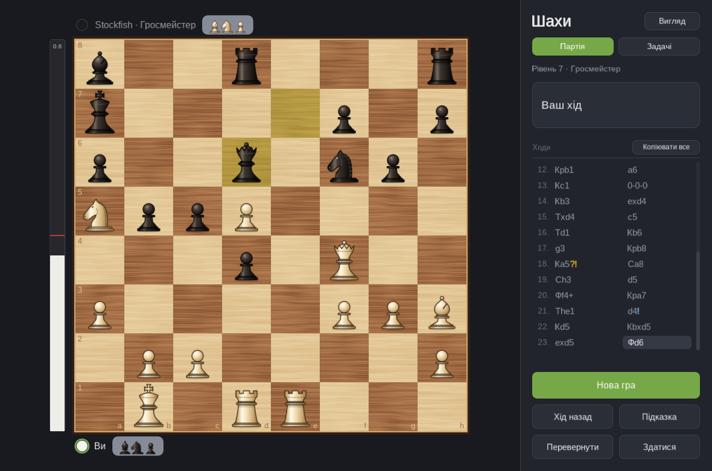

- play against the computer at eight difficulty levels — or anywhere between
  them, with a slider — or two people at one board;
- move by clicking or dragging; legal moves, the last move and check are highlighted;
- all the rules: castling, en passant, promotion with a choice of piece,
  checkmate, stalemate, and draws by threefold repetition, the fifty-move rule
  and insufficient material;
- the game is written down as it goes, with captured pieces and the material
  balance; the whole game or a single move can be copied;
- an evaluation bar to the left of the board: who is better and by how much,
  according to Stockfish;
- move marks as chess programs give them: `!!`, `!`, `?!`, `?`, `??`;
- badges on the kings for check, checkmate, stalemate, a draw and a resignation;
- take a move back, ask for a hint from the engine at full strength, flip the
  board, resign;
- a separate “Задачі” (Problems) mode: a position editor that says at once
  whether the position could occur in a game at all, and problem solving — 23
  mate problems come with the game, and you can add your own; Stockfish checks
  every move;
- a choice of looks: seven sets of pieces (classic, diagram, Gothic, anime,
  bone, ancient and pixel) and eight boards, in any combination;
- the window resizes freely; while nothing is happening the game draws nothing
  and uses no CPU at all.

Runs on macOS and Linux. The interface is in Ukrainian, and so is the notation
(Кр, Ф, Т, С, К for K, Q, R, B, N); the screenshots show it as it is.

## Building

```bash
cmake -S . -B build -DCMAKE_BUILD_TYPE=Release
cmake --build build -j                  # the rules, the tests and the game
ctest --test-dir build --output-on-failure
cmake --build build --target run        # start the game
```

You need CMake 3.22 or newer, git, a C++20 compiler, `make` and PowerShell
(`pwsh` — axmol's build scripts require it; on macOS:
`brew install cmake powershell`). Nothing else has to be prepared. Everything
the game depends on lives in `third-party/`, pinned to a tag — nothing is
borrowed from other projects on the machine and nothing is installed into the
system:

| Folder | Version | What for |
|---|---|---|
| `third-party/axmol` | `v2.9.1` | the UI engine |
| `third-party/Stockfish` | `stockfish-dev-20260930-49ea5ded` | the opponent and the evaluation |
| `third-party/googletest` | `main` of 2026-10-02 (`988ea2c`) | the tests only |

These are git submodules, and the commit each one is at is part of the
repository's history. Cloning with `--recurse-submodules` is not required: the
configure step fetches the submodule it needs when it needs it (the tests do
not pull in a graphics engine). In a copy without git — an archive, a folder
that is not under version control — it fetches each dependency at the same
commit instead: the commits are written down in `cmake/Chess.cmake` as well.
Commits, not tags: Stockfish's development tags are deleted after a while, and
a tag can be moved.

That makes the first build long, and it needs the network:

- the dependencies are fetched (as shallow clones);
- `axslcc`, axmol's shader compiler, is downloaded into
  `third-party/axmol/tools/external`;
- axmol downloads its own prebuilt libraries (zlib, OpenSSL, curl…) into its
  own folder;
- axmol is built — the longest part;
- Stockfish is built by its own Makefile, in place in
  `third-party/Stockfish/src`, and downloads its neural network once, about
  100 MB. Everything it leaves there is covered by its own `.gitignore`, so its
  checkout stays clean, and the network survives `rm -rf build`.

A dependency is moved to another version the way any submodule is: check out
the tag you want, commit — and write the same commit and its name into
`cmake/Chess.cmake` (`git ls-files -s third-party` shows the commit), so that a
copy without git gets the same thing. All the game needs from Stockfish
is the UCI protocol and the `UCI_LimitStrength` and `UCI_Elo` options, so
another recent release (`sf_19`, say) should do; only this tag has been tried.

A word about `axslcc`. axmol's own `setup.ps1` can install it, but the same
script rewrites the `AX_ROOT` variable in the shell profiles and in launchd —
one axmol project changing the environment of all the others. So `setup.ps1` is
never run here: only the one archive that is needed is fetched. For the same
reason the build ignores the `AX_ROOT` environment variable, whatever it holds;
a different axmol can only be chosen explicitly, with `-DAX_ROOT=…`.

On macOS the finished application is the bundle `build/bin/Chess/Chess.app`,
with Stockfish inside it next to the executable. On Linux it is
`build/bin/Chess/Chess`.

Options:

- `-DCHESS_BUILD_APP=OFF` — the rules, the engine client and the tests only, no
  graphics (seconds instead of minutes).
- `-DCHESS_BUILD_TESTS=OFF` — the other way round.
- `-DCHESS_STOCKFISH_BINARY=…` — bundle this ready-made engine (Stockfish or
  any other UCI engine) instead of building one.
- `-DCHESS_STOCKFISH_ARCH=…` — the processor Stockfish is built for (its
  `ARCH`; `make help` in `third-party/Stockfish/src` lists them). On a Mac the
  default is one that every Mac of the kind runs — `apple-silicon`, or
  `x86-64-sse41-popcnt` on Intel — since the engine travels inside
  `Chess.app`; elsewhere it is `native`, this machine only. Changing it
  rebuilds the engine.
- `-DAX_ROOT=…` — build against an axmol that lives elsewhere instead of
  `third-party/axmol`.
- `-DCHESS_FULL_ENGINE=ON` — build axmol with all of its modules. By default
  the game turns off what it does not use (Lua, Spine, physics, 3D, audio,
  video, networking) and builds several times faster. If the trimmed
  configuration fails to build somewhere, this goes back to axmol's defaults.
  Switch it in a clean build directory: axmol remembers its options in
  `CMakeCache.txt`.
- `-DCHESS_BOOTSTRAP=OFF` — download nothing: no dependencies, no `axslcc`. For
  an environment prepared in advance (CI, a machine without network).
- `-DCHESS_SANITIZE=ON` — ASan and UBSan for this project's own code.

`game/` is also a CMake project in its own right (`cmake -S game -B build/game`):
axmol is designed to be the top level of a build.

A build directory remembers where axmol was: dozens of paths in
`CMakeCache.txt`. If the engine has moved (you built with `-DAX_ROOT` before,
for instance), the old directory will not follow it, and the configure step
stops and asks you to delete it.

On Linux axmol needs these development packages: `libgtk-3-dev libgl1-mesa-dev
libx11-dev libxrandr-dev libxinerama-dev libxcursor-dev libxi-dev
libfontconfig1-dev libwebkit2gtk-4.1-dev`. Windows is not supported: starting
Stockfish is written for POSIX only (`engine/uci/src/Process.cpp`).

## Playing

The game opens with the “Нова гра” (New game) dialog: opponent, colour and
difficulty. The choice is remembered until the next run — in
`~/Library/Application Support/dev.chess.app/` on macOS and in
`~/.config/Chess/` on Linux.

A game that has moves on the board and no result yet cannot be lost by
accident: before a new game and before the window closes, the game asks. Close
it a second time without answering and it closes.

| Action | Mouse | Key |
|---|---|---|
| Move | click a piece, then a square — or drag it | |
| New game | button | `N` |
| Take back | button | `U`, `←` or `Backspace` |
| Hint | button | `H` |
| Flip the board | button | `F` |
| Looks of the pieces and the board | the “Вигляд” button | `V` |
| Problems and the position editor | the “Партія / Задачі” switch under the title | `P` |
| Deselect, cancel a promotion | click off the board | `Esc` |
| Scroll the move list | wheel over the list, or drag the scroll bar | |
| Copy the whole game | the “Копіювати все” (Copy all) button | `C` |
| Copy one move | click the move in the list | |

In the new-game dialog the digits `1`–`8` pick a level, `↑` and `↓` go to the
neighbouring level, `←` and `→` move the difficulty slider one step, and `Enter`
starts.

Against the computer, “take back” returns to your own previous turn — it takes
back your move and the reply to it. After a resignation the same button undoes
the resignation. If you then make the same move again, the opponent answers as
it did the first time (why that is not self-evident is explained below, under
the levels).

The game is copied as PGN — the tags and the moves in English notation (`Nf3`,
`O-O`), because that is what every chess program and site reads: it can be
pasted into the analysis board on lichess, for instance. A single move is
copied the way it is written in the list, with its number: `12. Кf3`,
`12... Кf6`.

### Problems and the position editor

Under the title of the game there is a switch, “Партія / Задачі” (Game /
Problems). Problems are a mode of their own: the game in progress waits where it
was left meanwhile, and the “Партія” switch brings it back. Before the first
game, the “Задачі” button in the new-game dialog leads there.

**The position editor.** Above and below the board are rows of pieces, black
and white, with an eraser at the end. Drag a piece from a row onto a square, or
click it in the row and then put it down with clicks (a click on the same piece
removes it). Pieces on the board can be dragged to another square, or off the
board to remove them; a right click removes too. There is one king of each
colour: putting down a second one moves him. The panel has the side to move,
the castling rights (available only while the king and that rook are on their
squares), en passant (the squares where it really is possible), FEN — copy, or
paste from the clipboard — and the starting position, clear, flip.

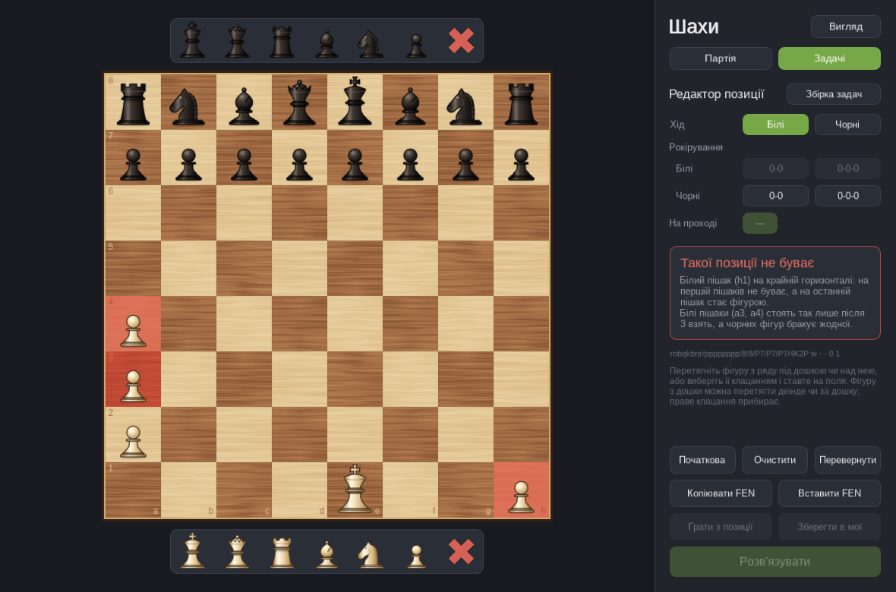

After every change the game says whether the position could have arisen in a
game, and the squares that make it impossible turn red:

- no king (the position is not finished yet), more than one king;
- a pawn on the first or the last rank;
- the kings side by side; the side that has just moved is in check;
- a check no single move could have given: from three pieces, from two
  “direct” ones (a pawn's or a knight's check cannot be uncovered), from a pawn
  still on its starting square;
- more than eight pawns; more pieces than promotions allow (every piece beyond
  the starting set is a pawn that is no longer there); bishops are counted by
  the colour of their squares, and a bishop shut in by its own unmoved pawns
  (c1 behind b2 and d2) can be nowhere but at home;
- pawns standing where they could only be after more captures than the other
  side has pieces missing (a pawn changes file only by capturing; the fewest
  captures are worked out as an assignment problem);
- an en passant square that does not fit the check on the board.

These are the checks problem composers and arbiters use, short of a full
retrograde analysis: a position that passes them may still be unreachable in
some subtle way; one that fails any of them certainly is. Once the position is
possible, Stockfish studies it and says what it found: “Білі ставлять мат у 3
ходи” (white mates in 3 — the shortest mate, up to eight moves), or an
evaluation.

From there: “Розв'язувати” (solve), “Грати з позиції” (play from the position:
the new-game dialog, and the game against the computer or for two starts from
it) and “Зберегти в мої” (save to my problems).

**Solving.** A problem is a position and a goal: mate in so many moves, or, if
there is no forced mate, the best move. It carries no solution: Stockfish checks
each of your moves (is there still a mate in the moves that are left?), answers
a right one with the stoutest defence, and marks a wrong one `?` and takes it
back. So any move that really mates in time is accepted — including one the
composer did not foresee. There is a hint (an arrow on the key move), the
solution (the engine plays it out), take back, start again, and “Змінити
позицію” (edit the position) to go to the editor.

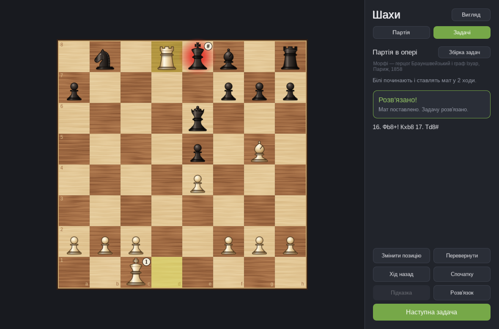

The collection (“Збірка задач”) has 23 problems: mates in one on the known
patterns (smothered, Arabian, Anastasia's, Boden's, epaulette, scholar's,
fool's…), in two (Morphy's problem, the Opera Game, Légal's mate…), in three to
five (the Immortal Game, Philidor's legacy…), and “Мої задачі”, your own. Each
was checked with Stockfish: a mate in exactly that many moves and, all but “Дві
тури” (two rooks), with a single first move. Problems solved unaided (no hint,
no solution) get a tick; “Наступна задача” (next problem) goes to the first one
not yet solved.

### Looks

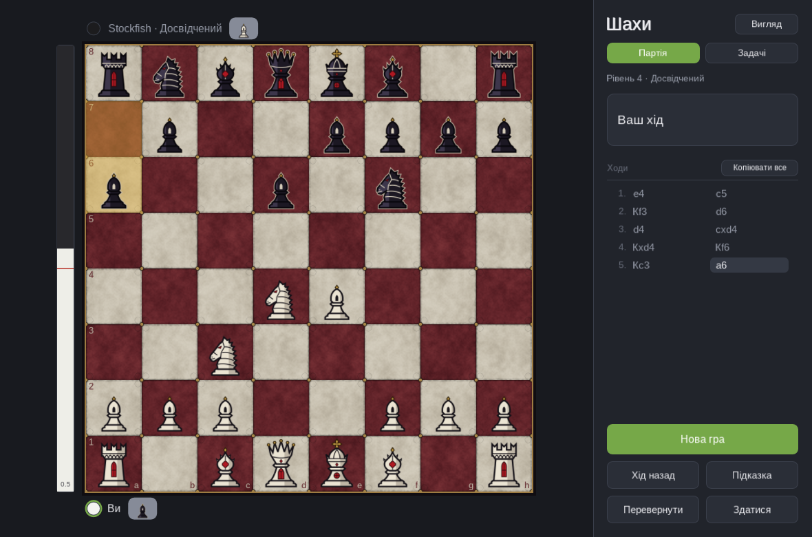

The “Вигляд” (Appearance) button at the top of the panel, or `V`, opens the
choice of pieces and board. They are chosen separately, so any set stands on
any board. A choice takes effect at once — in the middle of a game too, with
nothing restarted — and is remembered until the next run. In the dialog `←` `→`
step through the boards, `↑` `↓` through the pieces, and `Enter` or `Esc`
closes it.

| Pieces | |
|---|---|
| Класичні (Classic) | Staunton pieces off a lathe: boxwood and ebony, with light and shade |
| Діаграмні (Diagram) | the pieces of a chess book: flat, black and white, nothing but an outline and a few lines inside it |
| Ґотичні (Gothic) | bone and ink: spires, lancet arches, stained glass, swallow-tail battlements |
| Аніме (Anime) | the same six classic silhouettes drawn as a cartoon would draw them: flat colour, a white edge, and a face of its own on every piece |
| Кістяні (Bone) | turned bone, as sets were before Staunton: one side pale, the other stained red; yellowed and cracked |
| Старовинні (Ancient) | chaturanga, an ancient Indian army: a king under a parasol, a counsellor, a chariot, an elephant, a horseman, a foot soldier; ivory against blackened wood |
| Піксельні (Pixel) | pixel art: the pieces on a grid of 32 × 32, five tones a side and a dark outline |

| Board | |
|---|---|
| Дерево (Wood) | maple and walnut: every square its own piece of veneer, a dark frame with one pale thread |
| Ґотика (Gothic) | a church floor: limestone and oxblood, worn flags, a quatrefoil round a brass stud where four meet |
| Мармур (Marble) | cool grey |
| Смарагд (Emerald) | the green baize of a tournament hall |
| Сакура (Sakura) | cream and pink, flat as a frame of a cartoon, with fallen petals |
| Шкіра (Leather) | an old tooled board: vellum and dark calf, every square ruled round with a line, foxed and cracked |
| Камінь (Stone) | slabs of buff and red sandstone, chipped and pitted by time |
| Пікселі (Pixels) | pixel tiles of 32 × 32, cream and green, on the same grid as the pixel pieces |

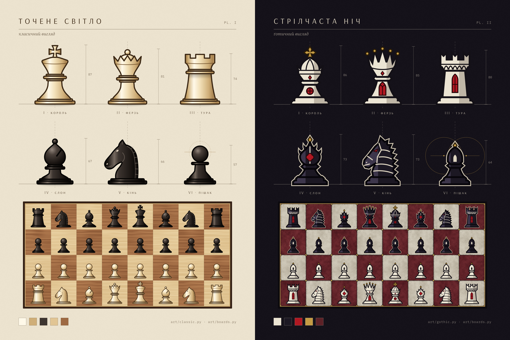

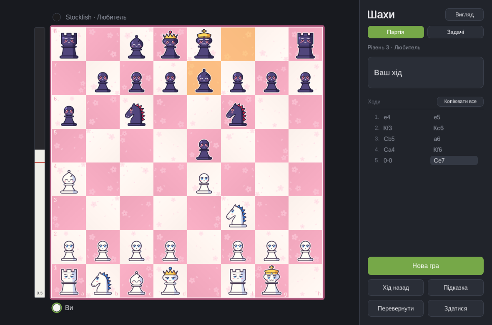

The anime set is chess pieces first: a pawn's ball, a rook's battlements, a
knight's head, a bishop's cut mitre, a queen's pointed coronet, a king's crown
and cross. What is anime about it is the manner: flat colour with one hard
shadow, a white edge like a sticker's, and a face — a different one on every
piece. The pawn is wide-eyed, the knight pleased with itself, the bishop
smiling with its eyes shut, the rook stern, the queen all eyelashes, the king
calm behind a small moustache. The light side is cream with blue eyes, the dark
side violet with red ones; the crowns are gold on both.

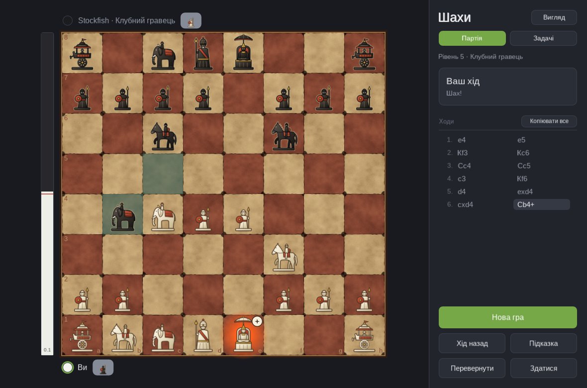

The ancient set is chess before it was chess: chaturanga, the game of the four
arms of an ancient Indian army and the king they fight for. The pieces are
that army:

| Piece | In chaturanga | As drawn |
|---|---|---|
| king | the raja | cross-legged on his throne under the royal parasol |
| queen | the mantri, a counsellor | a tall man in a long robe and a turban, with a staff |
| rook | the ratha, a chariot | a war chariot: a great wheel, a car, a tiered canopy flying a pennant |
| bishop | the gaja, an elephant | an elephant with its driver on its neck |
| knight | the ashva, cavalry | a horse and its rider |
| pawn | the padati, infantry | a soldier with shield and spear |

They move as ordinary chess pieces do — only the look is changed. One side is
ivory, the other blackened wood; both keep what is left of their paint — red
ochre on cloths and shields, a little gold on crowns. The dark pieces are worn
pale along their edges, so they do not sink even into a dark square. Size here
is rank, as in old carving, where whoever matters more is larger, and it runs
in the same order as worth: foot soldier, horseman and elephant, chariot,
counsellor, king.

The Stone board is red, so its marks are other colours: the last move is
greenish, the selected square yellow, check a hot orange.

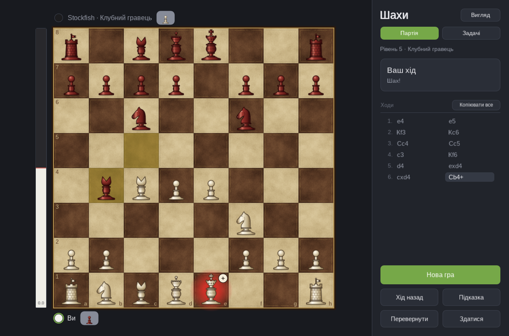

The bone set is the kind that stood on tables before Staunton's: turned
bone, one side left its own colour and the other stained red (red plays Black
here). A piece is a string of beads — a domed foot, a ring, a reel, a barrel, a
collar — with what it is on top. The king has a pierced gallery and a cross,
the queen a coronet of balls, the rook is a brick tower flying a pennant, the
bishop's mitre is split into two horns, the knight is a small carved head on a
pedestal, the pawn a ball on a baluster. The bone has yellowed and cracked
along its grain, and dirt has settled where one bead meets the next.

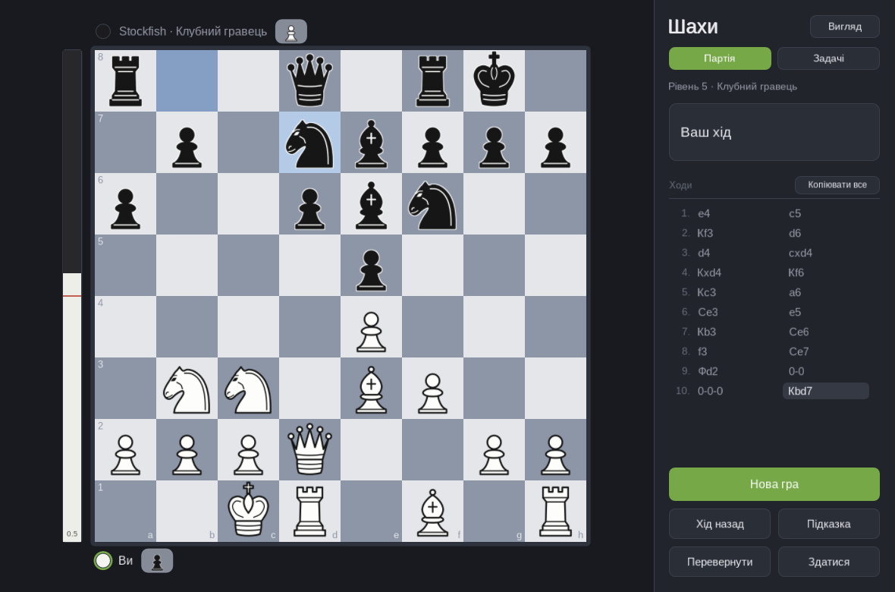

The diagram set is the pieces a book prints a position with: flat, with no
volume and no shadow, White as paper inside an ink outline, Black as solid ink
with the same lines left white. The manner itself is as old as chess books and
belongs to nobody; the outlines were drawn for this game from nothing, and no
existing set or font was traced. The black pieces have a hairline of light
round them, so they do not sink even into a dark square.

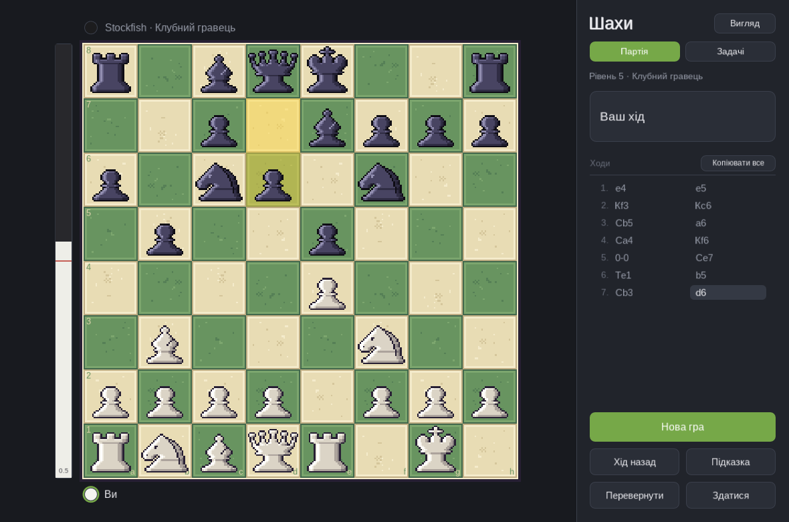

The pixel set is the pieces as an old game console would have drawn them: a
grid of 32 × 32, five tones a side and one dark outline. The silhouettes are
the ordinary chess ones: the pawn's ball, the rook's battlements, the knight's
head, a mitre with its cut, the queen's crown with a ball on each point, the
king's crown and cross. The Pixels board is drawn on the same grid, so a pixel
of a piece and a pixel of the square under it are the same size and sit on the
same lines. The light pieces are cream, the dark ones grey-violet, the squares
cream and green, so neither side sinks into the board. The game reduces these
pictures to the size of a square differently from all the others: with no
smoothing, pixel for pixel, so that the edges stay hard on an ordinary screen
too. Where a square is not a whole number of grid cells across, some pixels of
the drawing come out one screen pixel wider than others; in a large window or
on a Retina screen that cannot be seen at all.

In all seven sets a piece's size goes by what it is worth: the pawn is the
smallest, the knight and the bishop are alike, the rook stands above them, then
the queen and the king. (Which is why the rook here is taller than the bishop,
though in a real Staunton set it is shorter.)

Any set stands on any board:

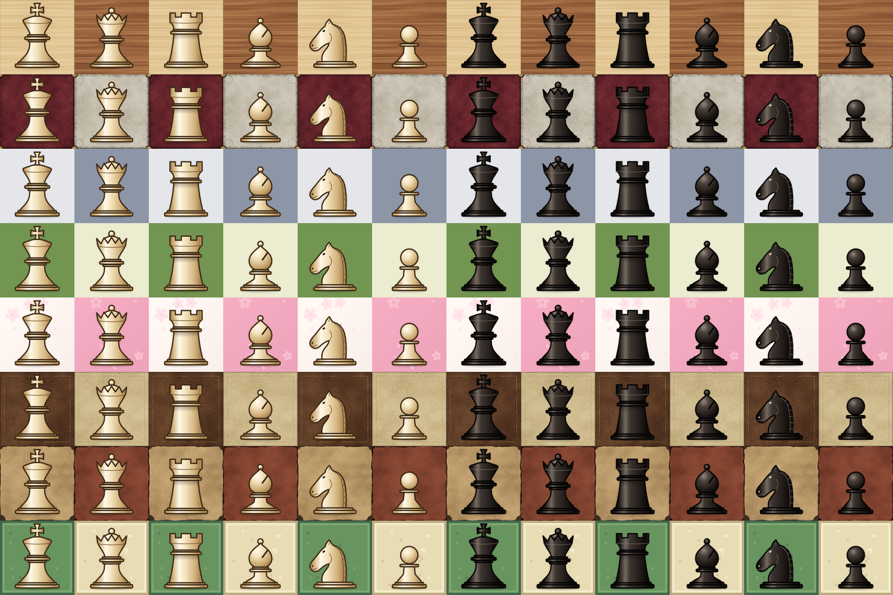
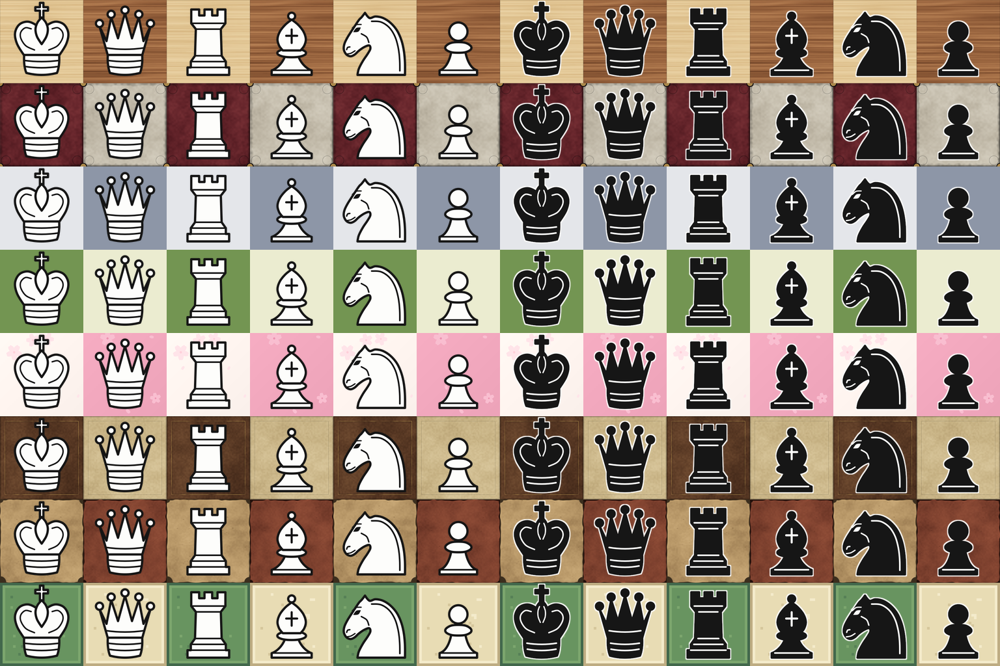
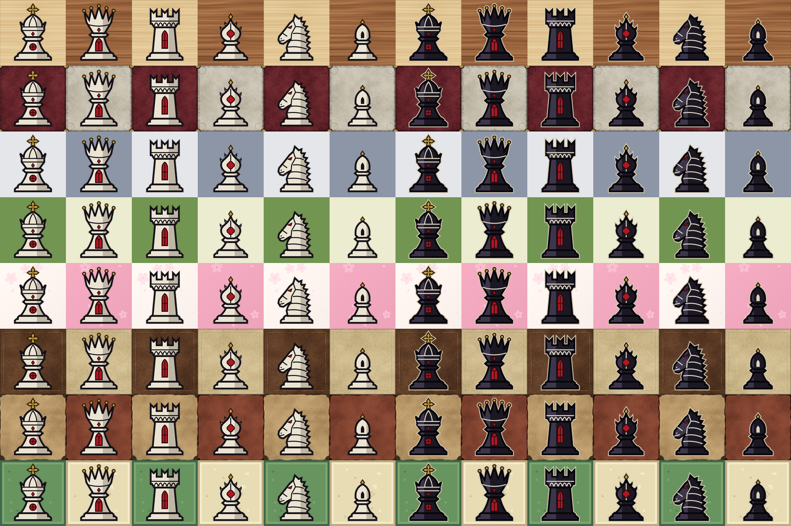
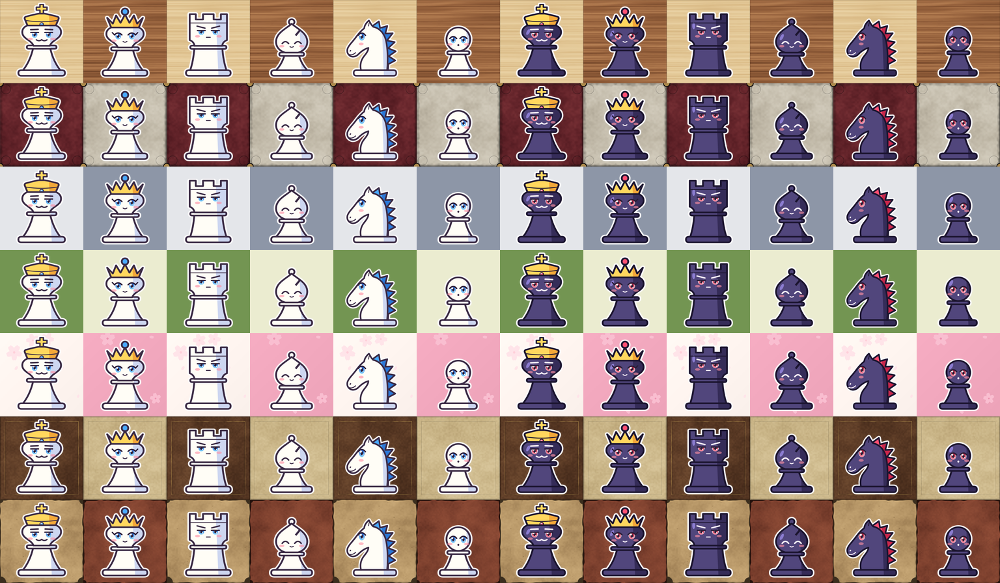
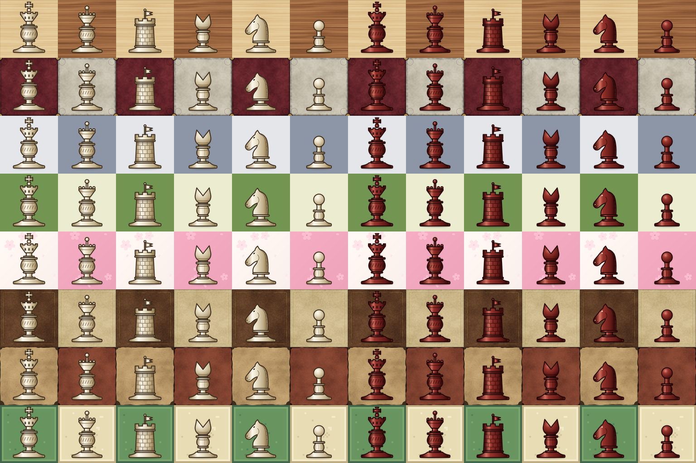
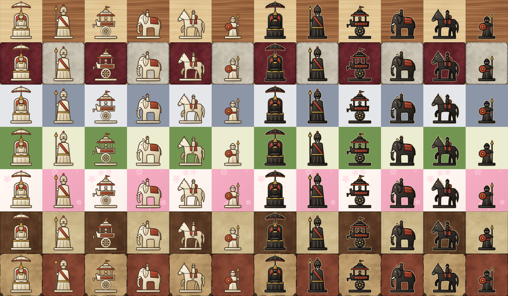
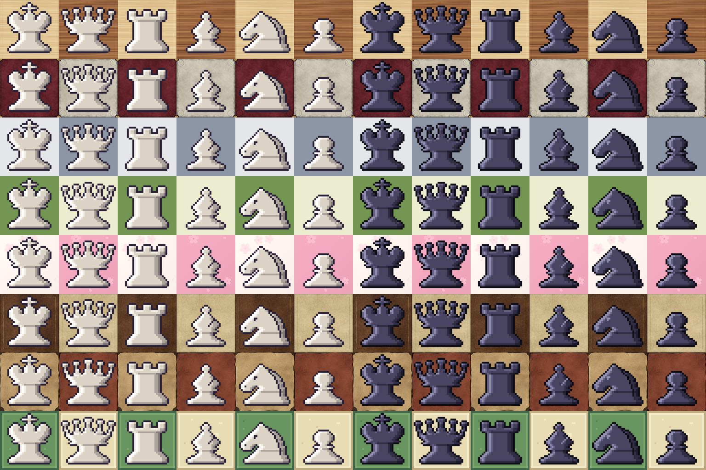

The marks on the board — last move, selected square, where a piece can go,
check — are each board's own: a green selection would be lost on the oxblood,
and a red check on it would be no warning at all.

All seven sets and the six pictured boards were drawn for this game, and all
of it is code in `art/`. A set is one file (`art/classic.py`, `art/diagram.py`,
`art/gothic.py`, `art/anime.py`, `art/bone.py`, `art/ancient.py`): twelve pieces described as outlines on a
100 × 100 square, from which it writes the SVGs (`art/<set>/`) and the PNGs the
game loads. The pixel set (`art/pixel.py`) is described differently: the body
of each piece row by row on a grid of 32 × 32, with the outline and the light
worked out by the script. To change something, change a number and run
`python3 art/gothic.py --sheet` (it needs `rsvg-convert` and Pillow). The
squares of the Wood, Gothic, Sakura, Leather, Stone and Pixels boards come from
`art/boards.py` (which also needs numpy): two pictures a board, four different
squares in each, and the game lays them so that neighbours do not repeat. What
they share is `art/kit.py`; the thinking it was all drawn from is
`art/DESIGN.md` (in Ukrainian); the plate above is drawn by `art/plate.py`.

Adding your own: a set of pieces is a folder of twelve PNGs (`wK.png` …
`bP.png`) in `game/Content/pieces/` and a line in the table in
`game/Source/Look.cpp`; a board is a line in the table next to it and, if it
is more than two flat colours, a folder with `light.png` and `dark.png` in
`game/Content/boards/`. The buttons in the dialog appear by themselves.

### The evaluation bar

To the left of the board is the evaluation of the position: a strip that is
half white when the game is level and fills with the colour of whoever is
better. The number at the leading side's end is the advantage in pawns (`1.3`),
or `#4` for mate in four. Once the game is over it shows the result.

The evaluation comes from a second copy of Stockfish that takes no part in the
game: it looks at every position at full strength, whatever level the opponent
is playing at. The hint comes from the same place — it is the move that copy
would play. The bar moves at once and refines for up to a second; the curve is
the one chess sites use: a pawn up is about 59% of the strip, three pawns 75%,
five 86%.

### Move marks

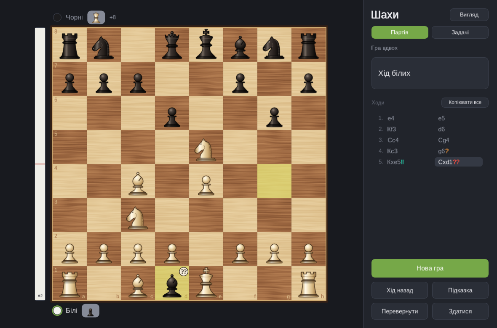

After a move a sign may appear next to it in the list, and on the board a small
disc with the same sign on the square the piece went to. Every badge on the
board is made the way a book would print it: a disc the colour of paper, ruled
round in ink, with the sign in a serif face — no pictures and no colours, only
chess notation. (In the move list the signs keep their colours.)

| Sign | Meaning | When it is given |
|---|---|---|
| `!!` | brilliant | a sacrifice that works: the move leaves at least two pawns' worth of material to be taken, it is no worse than the best move, and the game was not won without it. The sign goes to the move that makes the offer, not to each later one that leaves it standing |
| `!` | great | the only good move, and one that had to be found: the next best is worse by at least 10% of the winning chance |
| `?!` | inaccuracy | the move gave up 5% of the winning chance or more |
| `?` | mistake | 10% or more |
| `??` | blunder | 15% or more |

Stockfish does not judge moves — it judges positions. A sign comes from
comparing two of its evaluations: what the position was worth before the move
(that is, with the best move played) and what it was worth after the move that
was actually made. The difference is counted not in pawns but in winning
chances — on the same curve as the bar: a pawn lost in a level position matters
a great deal, and one lost when a queen up does not matter at all. The
thresholds for `?!`, `?` and `??` are the ones lichess uses. A move the engine
itself called best never gets a bad sign.

`!` is not given to a forced move, however far ahead of the alternatives it is:
a capture that simply wins material, a recapture, an answer to a check and
saving a piece that was about to be taken are all left unmarked.

Both sides' moves are marked, a moment after they are made: each needs two
positions evaluated. If the game moved on faster than the engine could look (at
the lower levels the opponent replies in a fraction of a second), it comes back
to the positions it missed as soon as it is free, the latest first. The signs
also go into a copied game (`Nxe5!!`) and a copied move.

A move is judged by what the engine said about the position when it had looked
exactly 16 plies deep — not by its last word, which depends on how long it was
given. So the same game gets the same signs on a fast machine and a slow one,
today and tomorrow. (A machine that has no time for that judges by what it
reached, if that is at least 14.) A position the engine has already seen — a
move taken back, or the same position reached by another order of moves — is
not looked at a second time.

Bear in mind that these are an engine's signs at a modest depth, not a
commentator's: `!!` means “a sacrifice, and a sound one”, not “beautiful” or
“hard to find”.

### Signs on the kings

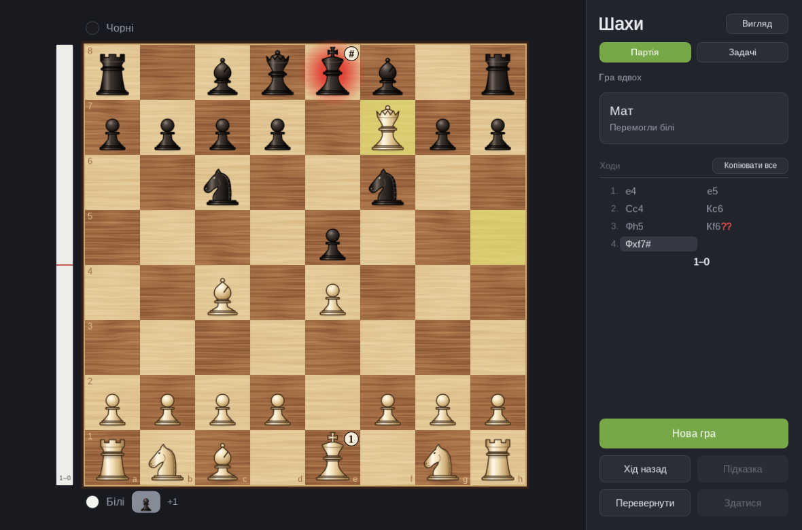

How the game stands is shown on the board as well — the same kind of disc in
the corner of a square, but on a king:

| Sign | On whom | Meaning |
|---|---|---|
| `+` | the king in check | check |
| `#` | the king that has been mated | checkmate |
| `1` | the winner's king | a win — by checkmate or because the opponent resigned |
| `0` | the king of the side that resigned | resignation |
| `½` | both kings | a draw: stalemate, threefold repetition, fifty moves, insufficient material |

These are the signs a game is written down with on a score sheet: the `1` and
the `0` on the kings add up to the score `1–0` or `0–1`, two `½` to `½–½`.
Which kind of draw it is, the panel on the right says. Once the game is over
its score appears in the list under the last move: `1–0`, `0–1` or `½–½`. If
the last move was made by a king and has a mark of its own, the mark goes to
the left corner of the square and the game's sign stays in the right one.

### Difficulty levels

Stockfish at full strength loses to nobody, so difficulty is a matter of how
far it is held back. The engine can play to a given rating by itself
(`UCI_LimitStrength` / `UCI_Elo`), but its floor is around 1320 Elo, which is
already a confident amateur. Below that the game adds a handicap of its own:
some of the moves are made not by the engine but by chance.

| # | Name | How it plays | Time per move |
|---|---|---|---|
| 1 | Початківець (Beginner) | 1320 Elo, 35% of moves random | 0.15 s |
| 2 | Новачок (Novice) | 1320 Elo, 15% of moves random | 0.2 s |
| 3 | Любитель (Amateur) | 1320 Elo | 0.3 s |
| 4 | Досвідчений (Experienced) | 1600 Elo | 0.4 s |
| 5 | Клубний гравець (Club player) | 1900 Elo | 0.5 s |
| 6 | Кандидат у майстри (Candidate master) | 2200 Elo | 0.7 s |
| 7 | Гросмейстер (Grandmaster) | 2600 Elo | 1 s |
| 8 | Без обмежень (Unlimited) | full strength, up to 4 threads | 2 s |

The ratings are what Stockfish is asked for, not a strength measured against
people. The table lives in one place, `engine/uci/src/Difficulty.cpp`.

#### Between the levels

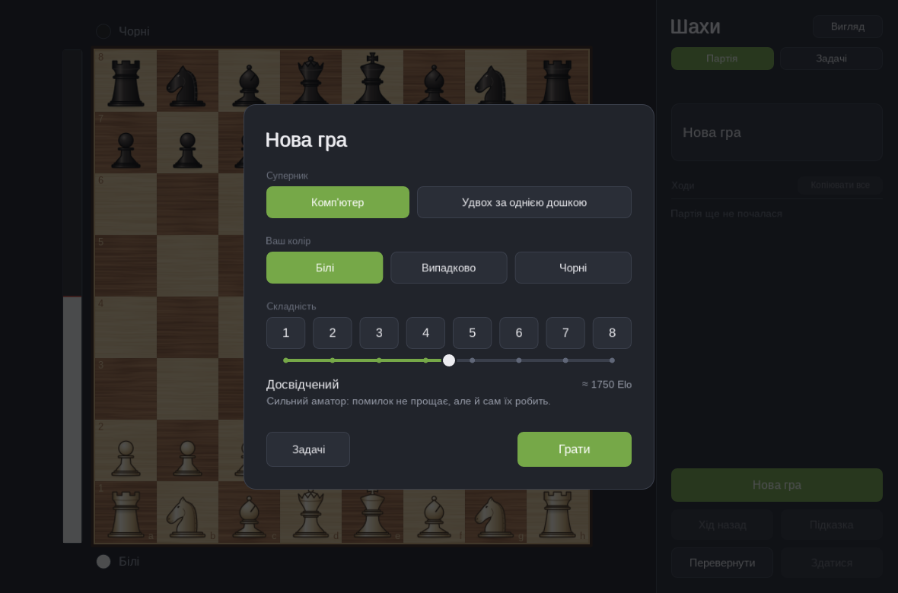

Eight steps are few: one level turns out too easy and the next already too
hard. So the levels are only stops on a longer scale, and under the level
buttons in the new-game dialog there is a slider that covers all of it, 224
positions:

- from level 1 to level 3, fewer and fewer random moves: from 35% down to
  none, one in a hundred fewer per step;
- from level 3 to 3190 Elo, the ceiling of Stockfish's `UCI_Elo`, the rating,
  10 Elo per step;
- the last step is no limit at all.

Time per move grows evenly from one level to the next: at 1750 Elo, halfway
between the fourth and the fifth, it is 0.45 s.

The slider can be dragged, clicked anywhere along it, or moved one step at a
time with `←` and `→`. Its marks stand under the buttons of their levels, so
the distance between neighbouring marks is the same while the number of steps
is not: where there are more of them, each is finer under the pointer. A level
button is lit only when exactly that level is chosen; above the description
are the name of the level already reached and what exactly is chosen — the
share of random moves, the rating, or “повна сила” (full strength). During a
game the panel says the same: “Рівень 4 · Досвідчений” for a level,
“Досвідчений · ≈ 1750 Elo” for a strength between two. In the PGN an opponent
between levels is written as `Stockfish, 1750 Elo`.

It is worth knowing *how* Stockfish plays weaker, because it shows at the
board. It does not “think worse”: at a shallow depth (the lower the rating the
shallower — at 1320 it is a single half-move) it takes the four moves it likes
best and draws one of them by lot, weighted by how much worse each is than the
first. Two consequences:

- Mistakes come in jumps. The opponent may play ten decent moves and then give
  up a piece to a two-move combination it could not see at its depth. The
  evaluation bar shows it immediately.
- In one and the same position it may play differently each time. That is why
  the game remembers its replies for the length of a game: otherwise “take
  back” followed by the same move would be a way to roll the dice again, and
  the opponent would find the refutation one time and miss it the next.

## How it is put together

```
engine/rules/                 the rules of chess; nothing but the standard library
  include/chess/Types.h       colours, pieces, squares, a move
  include/chess/Position.h    a position: FEN, legal moves, check, notation
  include/chess/Game.h        a game: history, taking back, how it ended, PGN
  include/chess/Judge.h       marking a move (!!, !, ?!, ?, ??) from two evaluations
  include/chess/Setup.h       a position from the editor: any at all, and why it is (not) possible
  src/Board.h                 what Position and Setup share: how pieces step, reading a FEN
  tests/                      perft, FEN, notation, draws, known games, possible positions
engine/uci/                   talking to the engine; knows nothing of the rules
  include/chess/Process.h     a child process with two pipes
  include/chess/Engine.h      UCI: ask for a move, cancel, get the answer later
  include/chess/Difficulty.h  the difficulty levels and the scale between them
  tests/                      a fake engine (sh) and the real Stockfish
engine/session/               the modes of the game without a screen: the rules + questions to the engine
  include/chess/PuzzleSession.h  a problem: a move, checking it, the defence, the hint, the solution
  include/chess/PositionProbe.h  a position in the editor: is there a mate in it (the shortest), and who is better
  include/chess/Opponent.h    the opponent in a game: when and how to answer — from memory, at random or by the engine
  include/chess/Watcher.h     the engine that watches the game: the bar, the move marks, the hint
  include/chess/GameReview.h  what the engine found about a game's positions, and the marks from it (for Watcher)
  include/chess/MoveList.h    the move list without the drawing: rows, numbers, scrolling, what the pointer is on
  tests/                      every step of it, with no window and no real engine
game/                         the axmol application
  Source/AppDelegate.*        the window, the command line, the main loop
  Source/GameScene.*          the game: brings Opponent, Watcher, their engines and the screen together
  Source/BoardNode.*          the board, the pieces, the marks, dragging
  Source/BoardInput.*         moving with the mouse: select, click-click, drag, promote — for both modes
  Source/EvalBar.*            the evaluation bar
  Source/Panels.*             the players' strips and the panel on the right (the move list drawn from MoveList)
  Source/Look.*               piece sets and boards: the tables, the current choice, drawing a board
  Source/Dialog.h             what every dialog shares: the card, the scrim, laying out only when open
  Source/NewGameDialog.*      the new-game dialog
  Source/LookDialog.*         the appearance dialog
  Source/ConfirmDialog.*      “the game is not finished”: asked before it is lost
  Source/PuzzleScene.*        the problems mode: the position editor; solving is drawn from PuzzleSession
  Source/PuzzlePanel.*        its panel on the right: two pages
  Source/PieceTray.*          the rows of pieces above and below the board
  Source/PuzzleDialog.*       the “Збірка задач” (collection) window
  Source/Puzzles.*            the collection and the player's own problems
  Source/Button.*             a button and a set of buttons
  Source/Slider.*             a slider with marks on it (the difficulty)
  Source/Shapes.*             antialiased shapes on top of DrawNode
  Source/Text.*               labels and line wrapping
  Source/Desktop.*            the clipboard, the window's events (resized, closed) and a picture of it (--shot)
  Source/Stockfish.*          where to find the engine, and the log of talking to it (CHESS_UCI_LOG=1)
  Source/EventLog.h           the event log the checks read (CHESS_EVENT_LOG=1)
  Source/Wakefulness.*        going to sleep: no reason to stay awake, no frames (CHESS_IDLE_LOG=1)
  Source/Strings.*            every word the game says
  Source/Theme.h              the colours of the interface around the board, the status card's tone
  Content/pieces/classic/     the classic pieces (PNG)
  Content/pieces/diagram/     the diagram pieces (PNG)
  Content/pieces/gothic/      the Gothic pieces (PNG)
  Content/pieces/anime/       the anime pieces (PNG)
  Content/pieces/bone/        the bone pieces (PNG)
  Content/pieces/ancient/     the ancient pieces, chaturanga (PNG)
  Content/pieces/pixel/       the pixel pieces (PNG)
  Content/boards/wood/        the squares of the Wood board (PNG)
  Content/boards/gothic/      the squares of the Gothic board (PNG)
  Content/boards/sakura/      the squares of the Sakura board (PNG)
  Content/boards/leather/     the squares of the Leather board (PNG)
  Content/boards/stone/       the squares of the Stone board (PNG)
  Content/boards/pixel/       the squares of the Pixels board (PNG)
  cmake/modules/              the game template from axmol 2.9.1
  proj.ios_mac/, proj.linux/  the entry points for macOS and Linux
art/classic.py                the classic set: where its SVGs and PNGs come from
art/diagram.py                the diagram set: likewise
art/gothic.py                 the Gothic set: likewise
art/anime.py                  the anime set: likewise
art/bone.py                   the bone set: likewise
art/ancient.py                the ancient set (chaturanga): likewise
art/pixel.py                  the pixel set: a grid of 32 × 32, outline and light worked out
art/classic/, art/diagram/, art/gothic/, art/anime/, art/bone/, art/ancient/, art/pixel/   their SVGs
art/boards.py                 the squares of the Wood, Gothic, Sakura, Leather, Stone and Pixels boards
art/kit.py                    what they share: outlines, rendering, the contact sheet
art/plate.py                  the plate docs/looks.png
art/DESIGN.md                 seven looks, seven schools: what it was all drawn from
cmake/Chess.cmake             the dependencies, preparing axmol, building Stockfish
tools/ui-checks/run.sh        the game under a pretend mouse: checks of behaviour (Linux)
docs/                         screenshots and the source of the icon
third-party/axmol/            axmol v2.9.1 (MIT)
third-party/Stockfish/        Stockfish, tag stockfish-dev-20260930-49ea5ded (GPLv3)
third-party/googletest/       googletest, main of 2026-10-02 (BSD-3-Clause), tests only
```

The rules have never heard of an engine or a window. The engine client does not
know the rules: moves cross its boundary as UCI text (`e2e4`). The modes of the
game (`engine/session`) know the rules and what to ask the engine, but have no
window and no engine process: solving a problem, the opponent in a game, the
engine watching it, the move marks and the move list are tested like the rules
are. So `engine/` is not only the engine but everything that lives and is
tested without axmol; `game/` keeps what draws and listens to the mouse. The nodes on screen show what they are told.
The scenes (`GameScene`, `PuzzleScene`) only bring it together: an event → the
model → what to draw and what to ask the engine. The rule that keeps the line:
no axmol in the models, no decisions about chess in the scenes.

**Stockfish is a separate process, and there are two of them.** The game starts
it and talks to it over stdin/stdout, as any chess interface does. One copy is
the opponent, held back to the chosen level. The other only watches: it
evaluates every position at full strength for the bar, the hint and the move
marks (which is why it reports its two best moves rather than one). They are
kept apart on purpose — the opponent's handicap never leaks into the
evaluation, and asking for a hint changes nothing about how the opponent plays.
(The network itself, a hundred megabytes, is in memory once for both.) The
opponent is started only when a game against the computer begins: in a game
between two people its process does not exist at all.

Nothing blocks: `search()` returns at once, a thread of its own reads the
answers, and the main thread collects a finished move once a frame and looks at
what the engine is thinking right now (`progress()`). A new question cancels
the previous one, so taking a move back while the engine is thinking does not
leave an answer on its way to a position that is no longer there. The engine is
given the whole game every time (`position startpos moves …`), so it counts
repetitions itself.

The engine is looked for in this order: the `CHESS_ENGINE` variable, then
`stockfish` next to the executable, then the path the build found, then `PATH`.
With no engine the game works in two-player mode; if the engine dies in the
middle of a game, the game says so and starts it again with the next new game.
`CHESS_UCI_LOG=1` prints both conversations to stderr: lines marked `uci` are
the opponent, `eval` the one that watches.

**The problems mode is a scene of its own, pushed over the game**
(`pushScene`/`popScene`): the game waits under it unchanged. The problems are
lent the engine that watches the game — while they are open the game has
nothing to look at; what it had found is kept, and on the way back it goes on
from the position on the board. They start no process of their own. That
engine runs on one thread, which is what the problems need: with several,
Stockfish sometimes ends a search restricted to one
move (`go mate N searchmoves …`) after a few plies and without the mate it would
have found — and that is exactly the search a player's move is judged by. If
no mate is found from the attacking side, before saying “no” the engine is also
asked from the defending side: is it mated within the moves that are left?

The engine is never asked the same thing twice. Answers in the problems are
remembered for as long as the mode is open, so the same move tried again, a
hint followed by the solution, or a problem started over cost no search; what
it said about a position in the editor is remembered for as long as the
program runs.

**The rules are an 8×8 array, not bitboards.** This library answers a person at
a board a few dozen times a second at most; the thinking is Stockfish's job.
Its correctness is checked by perft: the number of positions reachable in N
half-moves is compared with the published figures for six positions chosen to
exercise castling, en passant, pins and promotions.

**The antialiasing is the game's own.** axmol's `DrawNode` shader cuts the edge
of a shape as a step, and multisampling depends on the graphics backend. So
every circle and every rounded rectangle in `Shapes.cpp` is drawn as a solid
body with a one-pixel rim that fades to transparent — the same on OpenGL and
Metal.

**No action, no load.** After half a second of quiet the game stops drawing
frames (`Director::stopAnimation()`), and the main loop stops polling the
system and waits for it instead: `glfwWaitEvents()` returns only when there is
something for the window — a key, the mouse, a resize, a close. Meanwhile the
process is blocked in the kernel and does not wake up once; both Stockfish
processes are likewise waiting for a line on their input. Measured: on Linux,
0 wake-ups a second against 60 with axmol's stock loop; on macOS, Activity
Monitor shows 0.0% CPU and 0 idle wake-ups.

The loop is the game's own (`AppDelegate::runUntilClosed`) because axmol's
`Application::run()` is a game loop: sixty times a second it calls
`pollEvents()` and sleeps until the next frame, even when there are no frames.
Moving the pointer across the window does not wake the game either, unless it
changes something: there is only something to draw when the pointer moves onto
a button, off one, or is carrying a piece.

The one thing that does not arrive through the window is the engine's answer:
it turns up on another thread and is collected in `update()`, which only runs
while frames do. So the game never goes to sleep while it is owed something —
the opponent's move, the analysis of a position (and of the ones it is going
back over), the bar or a piece still moving. `CHESS_IDLE_LOG=1` prints to stderr what is keeping it awake at the
moment, and when it fell asleep. The timer and the log are `Wakefulness`,
shared by both modes; each scene gives its own list of reasons (in the problems
mode also the editor looking at a position, and the pause before the defence).

## Checking it

```bash
cmake -S . -B build -DCHESS_BUILD_APP=OFF && cmake --build build -j
ctest --test-dir build --output-on-failure
```

162 tests. Those that play against the real Stockfish skip themselves if the
binary is not there; among them are games at every level in which each move the
engine makes has to be legal by this project's own rules.

What a player does with the mouse is checked by `tools/ui-checks/run.sh`
(Linux only: Xvfb, xdotool, ImageMagick). It starts the built game in a virtual
display, clicks and drags pieces, and reads what came of it from the game's
event log (`CHESS_EVENT_LOG=1`): whether the engine answered, whether a move
was made after a take-back in the middle of a drag, whether the game goes to
sleep, whether "Розв'язок" shows the solution, and so on.

```bash
tools/ui-checks/run.sh build/bin/Chess/Chess            # all the checks
tools/ui-checks/run.sh build/bin/Chess/Chess mate_in_one
```

It finds the squares and the buttons where they are in a window of the size
the game opens at (1180 × 780).

The game itself has a few command-line options for looking at it without a
mouse:

```bash
Chess --play --level 5 --side black     # straight to the board
Chess --play --elo 1750                 # a strength between the levels: the nearest to this rating
Chess --fen "8/4P1k1/8/8/8/8/8/7K w - - 0 1" --two-players
Chess --moves "e2e4 e7e5 g1f3"          # play these moves and carry on
Chess --shot board.png                  # wait for the screen to settle, save it as a PNG and quit
Chess --pieces gothic --board marble    # a look for this run, leaving the saved one alone
Chess --autoplay 5 --level 3            # five games of random moves against the engine
Chess --puzzles                         # straight to the problems mode, in the editor
Chess --edit "4k3/8/8/8/8/8/8/4K2R w K -"   # the editor with this position
Chess --puzzle m2-morphy                # a problem from the collection (the ids are in Puzzles.cpp)
```

`--moves` takes both UCI (`e2e4`) and ordinary notation (`Nf3`, `O-O`).

## Other people's work

- **Stockfish** — GPLv3. The game does not link it; it runs it as a separate
  program.
- **axmol** — MIT.

All seven piece sets and all eight boards contain nobody else's work: they were
drawn for this project (the anime set is a style, not anybody's characters). (The classic set used to be Colin M.L. Burnett's “cburnett”,
GPLv2+; it has been replaced and survives only in the git history.)

The problems in the collection are well-known mating patterns and positions
from nineteenth-century games (Morphy, Anderssen, Légal, Philidor); the
set-ups were written down and checked for this game.

If you ever distribute a built application, the terms of the GPL apply to the
Stockfish binary in the bundle.
