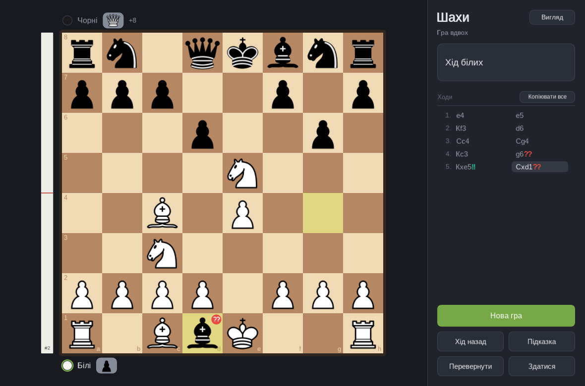
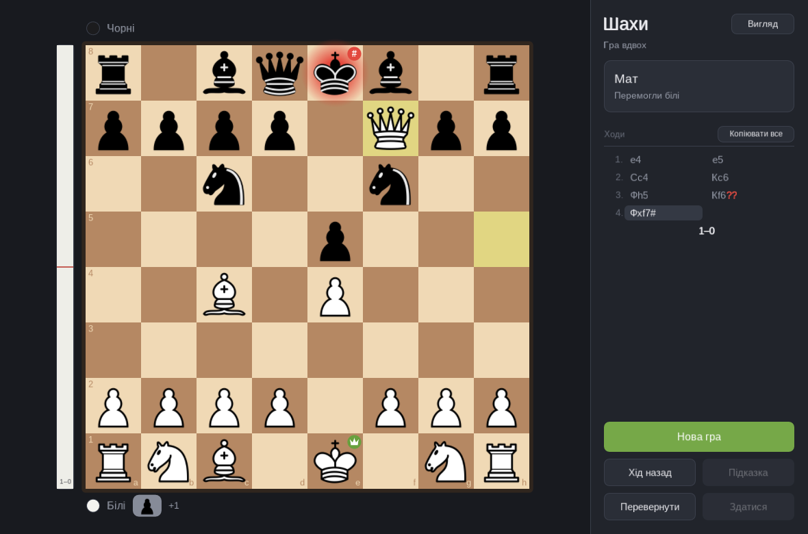

[Українська](README.md) · **English**

# Chess

A chess game with a graphical interface built on [axmol](https://axmol.dev/),
with [Stockfish](https://stockfishchess.org/) as the opponent.


- play against the computer at eight difficulty levels, or two people at one board;
- move by clicking or dragging; legal moves, the last move and check are highlighted;
- all the rules: castling, en passant, promotion with a choice of piece,
  checkmate, stalemate, and draws by threefold repetition, the fifty-move rule
  and insufficient material;
- the game is written down as it goes, with captured pieces and the material
  balance; the whole game or a single move can be copied;
- an evaluation bar to the left of the board: who is better and by how much,
  according to Stockfish;
- move marks as chess programs give them: `!!`, `!`, `?!`, `?`, `??`;
- badges on the kings for check, checkmate, stalemate, a draw and a resignation;
- take a move back, ask for a hint from the engine at full strength, flip the
  board, resign;
- a choice of looks: two sets of pieces (classic and Gothic) and four boards, in
  any combination;
- the window resizes freely; while nothing is happening the game draws nothing
  and uses no CPU at all.

Runs on macOS and Linux. The interface is in Ukrainian, and so is the notation
(Кр, Ф, Т, С, К for K, Q, R, B, N); the screenshots show it as it is.

## Building

```bash
cmake -S . -B build -DCMAKE_BUILD_TYPE=Release
cmake --build build -j                  # the rules, the tests and the game
ctest --test-dir build --output-on-failure
cmake --build build --target run        # start the game
```

You need CMake 3.22 or newer, git, a C++20 compiler, `make` and PowerShell
(`pwsh` — axmol's build scripts require it; on macOS:
`brew install cmake powershell`). Nothing else has to be prepared. Everything
the game depends on lives in `third-party/`, pinned to a tag — nothing is
borrowed from other projects on the machine and nothing is installed into the
system:

| Folder | Version | What for |
|---|---|---|
| `third-party/axmol` | `v2.9.1` | the UI engine |
| `third-party/Stockfish` | `stockfish-dev-20260930-49ea5ded` | the opponent and the evaluation |
| `third-party/googletest` | `v1.18.0` | the tests only |

These are git submodules, and the commit each one is at is part of the
repository's history. Cloning with `--recurse-submodules` is not required: the
configure step fetches the submodule it needs when it needs it (the tests do
not pull in a graphics engine). In a copy without git — an archive, a folder
that is not under version control — it clones each dependency at the same tag
instead: the tags are written down in `cmake/Chess.cmake` as well.

That makes the first build long, and it needs the network:

- the dependencies are fetched (as shallow clones);
- `axslcc`, axmol's shader compiler, is downloaded into
  `third-party/axmol/tools/external`;
- axmol downloads its own prebuilt libraries (zlib, OpenSSL, curl…) into its
  own folder;
- axmol is built — the longest part;
- Stockfish is built by its own Makefile, in place in
  `third-party/Stockfish/src`, and downloads its neural network once, about
  100 MB. Everything it leaves there is covered by its own `.gitignore`, so its
  checkout stays clean, and the network survives `rm -rf build`.

A dependency is moved to another version the way any submodule is: check out
the tag you want, commit — and change the same tag in `cmake/Chess.cmake`, so
that a copy without git gets the same thing. All the game needs from Stockfish
is the UCI protocol and the `UCI_LimitStrength` and `UCI_Elo` options, so
another recent release (`sf_19`, say) should do; only this tag has been tried.

A word about `axslcc`. axmol's own `setup.ps1` can install it, but the same
script rewrites the `AX_ROOT` variable in the shell profiles and in launchd —
one axmol project changing the environment of all the others. So `setup.ps1` is
never run here: only the one archive that is needed is fetched. For the same
reason the build ignores the `AX_ROOT` environment variable, whatever it holds;
a different axmol can only be chosen explicitly, with `-DAX_ROOT=…`.

On macOS the finished application is the bundle `build/bin/Chess/Chess.app`,
with Stockfish inside it next to the executable. On Linux it is
`build/bin/Chess/Chess`.

Options:

- `-DCHESS_BUILD_APP=OFF` — the rules, the engine client and the tests only, no
  graphics (seconds instead of minutes).
- `-DCHESS_BUILD_TESTS=OFF` — the other way round.
- `-DCHESS_STOCKFISH_BINARY=…` — bundle this ready-made engine (Stockfish or
  any other UCI engine) instead of building one.
- `-DAX_ROOT=…` — build against an axmol that lives elsewhere instead of
  `third-party/axmol`.
- `-DCHESS_FULL_ENGINE=ON` — build axmol with all of its modules. By default
  the game turns off what it does not use (Lua, Spine, physics, 3D, audio,
  video, networking) and builds several times faster. If the trimmed
  configuration fails to build somewhere, this goes back to axmol's defaults.
  Switch it in a clean build directory: axmol remembers its options in
  `CMakeCache.txt`.
- `-DCHESS_BOOTSTRAP=OFF` — download nothing: no dependencies, no `axslcc`. For
  an environment prepared in advance (CI, a machine without network).
- `-DCHESS_SANITIZE=ON` — ASan and UBSan for this project's own code.

`game/` is also a CMake project in its own right (`cmake -S game -B build/game`):
axmol is designed to be the top level of a build.

A build directory remembers where axmol was: dozens of paths in
`CMakeCache.txt`. If the engine has moved (you built with `-DAX_ROOT` before,
for instance), the old directory will not follow it, and the configure step
stops and asks you to delete it.

On Linux axmol needs these development packages: `libgtk-3-dev libgl1-mesa-dev
libx11-dev libxrandr-dev libxinerama-dev libxcursor-dev libxi-dev
libfontconfig1-dev libwebkit2gtk-4.1-dev`. Windows is not supported: starting
Stockfish is written for POSIX only (`engine/uci/src/Process.cpp`).

## Playing

The game opens with the “Нова гра” (New game) dialog: opponent, colour and
difficulty. The choice is remembered until the next run — in
`~/Library/Application Support/dev.chess.app/` on macOS and in
`~/.config/Chess/` on Linux.

A game that has moves on the board and no result yet cannot be lost by
accident: before a new game and before the window closes, the game asks. Close
it a second time without answering and it closes.

| Action | Mouse | Key |
|---|---|---|
| Move | click a piece, then a square — or drag it | |
| New game | button | `N` |
| Take back | button | `U`, `←` or `Backspace` |
| Hint | button | `H` |
| Flip the board | button | `F` |
| Looks of the pieces and the board | the “Вигляд” button | `V` |
| Deselect, cancel a promotion | click off the board | `Esc` |
| Scroll the move list | wheel over the list, or drag the scroll bar | |
| Copy the whole game | the “Копіювати все” (Copy all) button | `C` |
| Copy one move | click the move in the list | |

In the new-game dialog the digits `1`–`8` and the arrows pick the level, and
`Enter` starts.

Against the computer, “take back” returns to your own previous turn — it takes
back your move and the reply to it. After a resignation the same button undoes
the resignation. If you then make the same move again, the opponent answers as
it did the first time (why that is not self-evident is explained below, under
the levels).

The game is copied as PGN — the tags and the moves in English notation (`Nf3`,
`O-O`), because that is what every chess program and site reads: it can be
pasted into the analysis board on lichess, for instance. A single move is
copied the way it is written in the list, with its number: `12. Кf3`,
`12... Кf6`.

### Looks


The “Вигляд” (Appearance) button at the top of the panel, or `V`, opens the
choice of pieces and board. They are chosen separately, so any set stands on
any board. A choice takes effect at once — in the middle of a game too, with
nothing restarted — and is remembered until the next run. In the dialog `←` `→`
step through the boards, `↑` `↓` through the pieces, and `Enter` or `Esc`
closes it.

| Pieces | |
|---|---|
| Класичні (Classic) | the “cburnett” set, familiar from Wikipedia and lichess |
| Ґотичні (Gothic) | drawn for this game: spires, lancet arches, swallow-tail battlements |

| Board | |
|---|---|
| Дерево (Wood) | the brown pair of a club board |
| Ґотика (Gothic) | stone and oxblood, laid as tiles with a brass stud where four meet |
| Мармур (Marble) | cool grey |
| Смарагд (Emerald) | the green baize of a tournament hall |


The marks on the board — last move, selected square, where a piece can go,
check — are each board's own: a green selection would be lost on the oxblood,
and a red check on it would be no warning at all.

The Gothic set is one file, `art/gothic.py`: twelve pieces described as
outlines on a 100 × 100 square, from which it writes the SVGs (`art/gothic/`)
and the PNGs the game loads. To change something, change a number and run
`python3 art/gothic.py --sheet` (it needs `rsvg-convert` and Pillow).

Adding your own: a set of pieces is a folder of twelve PNGs (`wK.png` …
`bP.png`) in `game/Content/pieces/` and a line in the table in
`game/Source/Look.cpp`; a board is just a line in the table next to it. The
buttons in the dialog appear by themselves.

### The evaluation bar

To the left of the board is the evaluation of the position: a strip that is
half white when the game is level and fills with the colour of whoever is
better. The number at the leading side's end is the advantage in pawns (`1.3`),
or `#4` for mate in four. Once the game is over it shows the result.

The evaluation comes from a second copy of Stockfish that takes no part in the
game: it looks at every position at full strength, whatever level the opponent
is playing at. The hint comes from the same place — it is the move that copy
would play. The bar moves at once and refines for up to a second; the curve is
the one chess sites use: a pawn up is about 59% of the strip, three pawns 75%,
five 86%.

### Move marks



After a move a sign may appear next to it in the list, and on the board a small
disc with the same sign on the square the piece went to:

| Sign | Meaning | When it is given |
|---|---|---|
| `!!` | brilliant | a sacrifice that works: the move leaves at least two pawns' worth of material to be taken, it is no worse than the best move, and the game was not won without it |
| `!` | great | the only good move, and one that had to be found: the next best is worse by at least 10% of the winning chance |
| `?!` | inaccuracy | the move gave up 5% of the winning chance or more |
| `?` | mistake | 10% or more |
| `??` | blunder | 15% or more |

Stockfish does not judge moves — it judges positions. A sign comes from
comparing two of its evaluations: what the position was worth before the move
(that is, with the best move played) and what it was worth after the move that
was actually made. The difference is counted not in pawns but in winning
chances — on the same curve as the bar: a pawn lost in a level position matters
a great deal, and one lost when a queen up does not matter at all. The
thresholds for `?!`, `?` and `??` are the ones lichess uses. A move the engine
itself called best never gets a bad sign.

`!` is not given to a forced move, however far ahead of the alternatives it is:
a capture that simply wins material, a recapture, an answer to a check and
saving a piece that was about to be taken are all left unmarked.

Both sides' moves are marked, a moment after they are made: each needs two
positions evaluated. If the game moved on faster than the engine could look (at
the lower levels the opponent replies in a fraction of a second), it comes back
to the positions it missed as soon as it is free, the latest first. The signs
also go into a copied game (`Nxe5!!`) and a copied move.

Bear in mind that these are an engine's signs at a modest depth, not a
commentator's: `!!` means “a sacrifice, and a sound one”, not “beautiful”.

### Signs on the kings



How the game stands is shown on the board as well — the same kind of disc in
the corner of a square, but on a king:

| Sign | On whom | Meaning |
|---|---|---|
| `+` | the king in check | check |
| `#` | the king that has been mated | checkmate |
| a crown | the winner's king | a win — by checkmate or because the opponent resigned |
| a white flag | the king of the side that resigned | resignation |
| `½` | both kings | a draw: stalemate, threefold repetition, fifty moves, insufficient material |

Which kind of draw it is, the panel on the right says. Once the game is over
its score appears in the list under the last move: `1–0`, `0–1` or `½–½`. If
the last move was made by a king and has a mark of its own, the mark goes to
the left corner of the square and the game's sign stays in the right one.

### Difficulty levels

Stockfish at full strength loses to nobody, so difficulty is a matter of how
far it is held back. The engine can play to a given rating by itself
(`UCI_LimitStrength` / `UCI_Elo`), but its floor is around 1320 Elo, which is
already a confident amateur. Below that the game adds a handicap of its own:
some of the moves are made not by the engine but by chance.

| # | Name | How it plays | Time per move |
|---|---|---|---|
| 1 | Початківець (Beginner) | 1320 Elo, 35% of moves random | 0.15 s |
| 2 | Новачок (Novice) | 1320 Elo, 15% of moves random | 0.2 s |
| 3 | Любитель (Amateur) | 1320 Elo | 0.3 s |
| 4 | Досвідчений (Experienced) | 1600 Elo | 0.4 s |
| 5 | Клубний гравець (Club player) | 1900 Elo | 0.5 s |
| 6 | Кандидат у майстри (Candidate master) | 2200 Elo | 0.7 s |
| 7 | Гросмейстер (Grandmaster) | 2600 Elo | 1 s |
| 8 | Без обмежень (Unlimited) | full strength, up to 4 threads | 2 s |

The ratings are what Stockfish is asked for, not a strength measured against
people. The table lives in one place, `engine/uci/src/Difficulty.cpp`.

It is worth knowing *how* Stockfish plays weaker, because it shows at the
board. It does not “think worse”: at a shallow depth (the lower the rating the
shallower — at 1320 it is a single half-move) it takes the four moves it likes
best and draws one of them by lot, weighted by how much worse each is than the
first. Two consequences:

- Mistakes come in jumps. The opponent may play ten decent moves and then give
  up a piece to a two-move combination it could not see at its depth. The
  evaluation bar shows it immediately.
- In one and the same position it may play differently each time. That is why
  the game remembers its replies for the length of a game: otherwise “take
  back” followed by the same move would be a way to roll the dice again, and
  the opponent would find the refutation one time and miss it the next.

## How it is put together

```
engine/rules/                 the rules of chess; nothing but the standard library
  include/chess/Types.h       colours, pieces, squares, a move
  include/chess/Position.h    a position: FEN, legal moves, check, notation
  include/chess/Game.h        a game: history, taking back, how it ended, PGN
  include/chess/Judge.h       marking a move (!!, !, ?!, ?, ??) from two evaluations
  tests/                      perft, FEN, notation, draws, known games
engine/uci/                   talking to the engine; knows nothing of the rules
  include/chess/Process.h     a child process with two pipes
  include/chess/Engine.h      UCI: ask for a move, cancel, get the answer later
  include/chess/Difficulty.h  the difficulty levels
  tests/                      a fake engine (sh) and the real Stockfish
game/                         the axmol application
  Source/AppDelegate.*        the window, the command line, the main loop
  Source/GameScene.*          the game: brings the rules, the engine and the screen together
  Source/BoardNode.*          the board, the pieces, the marks, dragging
  Source/EvalBar.*            the evaluation bar
  Source/Panels.*             the players' strips and the panel on the right
  Source/Look.*               piece sets and boards: the tables, the current choice, drawing a board
  Source/Dialog.h             what the two dialogs share
  Source/NewGameDialog.*      the new-game dialog
  Source/LookDialog.*         the appearance dialog
  Source/ConfirmDialog.*      “the game is not finished”: asked before it is lost
  Source/Button.*             a button and a set of buttons
  Source/Shapes.*             antialiased shapes on top of DrawNode
  Source/Text.*               labels and line wrapping
  Source/Strings.*            every word the game says
  Source/Theme.h              the colours of the interface around the board
  Content/pieces/classic/     the classic pieces (PNG)
  Content/pieces/gothic/      the Gothic pieces (PNG)
  cmake/modules/              the game template from axmol 2.9.1
  proj.ios_mac/, proj.linux/  the entry points for macOS and Linux
art/gothic.py                 the Gothic set: where its SVGs and PNGs come from
art/gothic/                   its SVGs
cmake/Chess.cmake             the dependencies, preparing axmol, building Stockfish
docs/                         screenshots and the source of the icon
third-party/axmol/            axmol v2.9.1 (MIT)
third-party/Stockfish/        Stockfish, tag stockfish-dev-20260930-49ea5ded (GPLv3)
third-party/googletest/       googletest v1.18.0 (BSD-3-Clause), tests only
```

The three parts do not know about each other. The rules have never heard of an
engine or a window. The engine client does not know the rules: moves cross its
boundary as UCI text (`e2e4`). The nodes on screen show what they are told. All
of it meets in one place, `GameScene`.

**Stockfish is a separate process, and there are two of them.** The game starts
it and talks to it over stdin/stdout, as any chess interface does. One copy is
the opponent, held back to the chosen level. The other only watches: it
evaluates every position at full strength for the bar, the hint and the move
marks (which is why it reports its two best moves rather than one). They are
kept apart on purpose — the opponent's handicap never leaks into the
evaluation, and asking for a hint changes nothing about how the opponent plays.
(The network itself, a hundred megabytes, is in memory once for both.)

Nothing blocks: `search()` returns at once, a thread of its own reads the
answers, and the main thread collects a finished move once a frame and looks at
what the engine is thinking right now (`progress()`). A new question cancels
the previous one, so taking a move back while the engine is thinking does not
leave an answer on its way to a position that is no longer there. The engine is
given the whole game every time (`position startpos moves …`), so it counts
repetitions itself.

The engine is looked for in this order: the `CHESS_ENGINE` variable, then
`stockfish` next to the executable, then the path the build found, then `PATH`.
With no engine the game works in two-player mode; if the engine dies in the
middle of a game, the game says so and starts it again with the next new game.
`CHESS_UCI_LOG=1` prints both conversations to stderr: lines marked `uci` are
the opponent, `eval` the one that watches.

**The rules are an 8×8 array, not bitboards.** This library answers a person at
a board a few dozen times a second at most; the thinking is Stockfish's job.
Its correctness is checked by perft: the number of positions reachable in N
half-moves is compared with the published figures for six positions chosen to
exercise castling, en passant, pins and promotions.

**The antialiasing is the game's own.** axmol's `DrawNode` shader cuts the edge
of a shape as a step, and multisampling depends on the graphics backend. So
every circle and every rounded rectangle in `Shapes.cpp` is drawn as a solid
body with a one-pixel rim that fades to transparent — the same on OpenGL and
Metal.

**No action, no load.** After half a second of quiet the game stops drawing
frames (`Director::stopAnimation()`), and the main loop stops polling the
system and waits for it instead: `glfwWaitEvents()` returns only when there is
something for the window — a key, the mouse, a resize, a close. Meanwhile the
process is blocked in the kernel and does not wake up once; both Stockfish
processes are likewise waiting for a line on their input. Measured: on Linux,
0 wake-ups a second against 60 with axmol's stock loop; on macOS, Activity
Monitor shows 0.0% CPU and 0 idle wake-ups.

The loop is the game's own (`AppDelegate::runUntilClosed`) because axmol's
`Application::run()` is a game loop: sixty times a second it calls
`pollEvents()` and sleeps until the next frame, even when there are no frames.
Moving the pointer across the window does not wake the game either, unless it
changes something: there is only something to draw when the pointer moves onto
a button, off one, or is carrying a piece.

The one thing that does not arrive through the window is the engine's answer:
it turns up on another thread and is collected in `update()`, which only runs
while frames do. So the game never goes to sleep while it is owed something —
the opponent's move, the analysis of a position (and of the ones it is going
back over), the bar or a piece still moving. `CHESS_IDLE_LOG=1` prints to stderr what is keeping it awake at the
moment, and when it fell asleep.

## Checking it

```bash
cmake -S . -B build -DCHESS_BUILD_APP=OFF && cmake --build build -j
ctest --test-dir build --output-on-failure
```

87 tests. Those that play against the real Stockfish skip themselves if the
binary is not there; among them are games at every level in which each move the
engine makes has to be legal by this project's own rules.

The game itself has a few command-line options for looking at it without a
mouse:

```bash
Chess --play --level 5 --side black     # straight to the board
Chess --fen "8/4P1k1/8/8/8/8/8/7K w - - 0 1" --two-players
Chess --moves "e2e4 e7e5 g1f3"          # play these moves and carry on
Chess --shot board.png                  # wait for the screen to settle, save it as a PNG and quit
Chess --pieces gothic --board marble    # a look for this run, leaving the saved one alone
Chess --autoplay 5 --level 3            # five games of random moves against the engine
```

`--moves` takes both UCI (`e2e4`) and ordinary notation (`Nf3`, `O-O`).

## Other people's work

- **Stockfish** — GPLv3. The game does not link it; it runs it as a separate
  program.
- **The classic pieces** — Colin M.L. Burnett's “cburnett” set, GPLv2+, the one
  used by Wikipedia and lichess; the PNGs in `game/Content/pieces/classic/`
  were rendered from the SVGs in the lichess repository.
- **axmol** — MIT.

The Gothic set and all four boards contain nobody else's work: they were drawn
for this project.

If you ever distribute a built application, the terms of the GPL apply both to
the Stockfish binary in the bundle and to the classic piece set.
