**Українська** · [English](README.en.md)

# Шахи

Гра в шахи з графічним інтерфейсом на [axmol](https://axmol.dev/) і зі
[Stockfish](https://stockfishchess.org/) у ролі суперника.

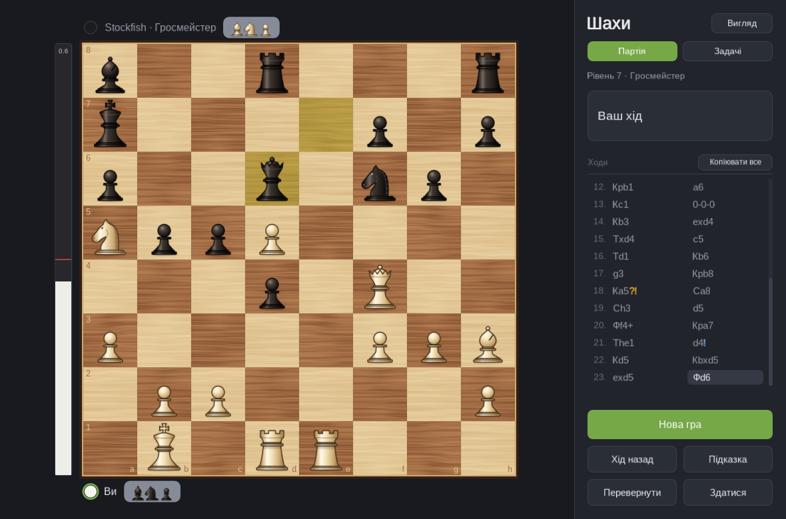

- гра проти комп'ютера на восьми рівнях складності — або будь-де між ними,
  повзунком, — чи вдвох за однією дошкою;
- ходи кліком або перетягуванням, підсвітка дозволених ходів, останнього ходу й шаху;
- усі правила: рокіровка, взяття на проході, перетворення пішака з вибором
  фігури, мат, пат, нічиї за триразовим повторенням, правилом 50 ходів і через
  нестачу матеріалу;
- запис партії українською нотацією, взяті фігури й перевага в матеріалі;
  партію цілком або окремий хід можна скопіювати;
- шкала оцінки ліворуч від дошки: хто стоїть краще й наскільки, за Stockfish;
- оцінки ходів, як у шахових програмах: `!!`, `!`, `?!`, `?`, `??`;
- значки на королях для шаху, мату, пату, нічиєї та здачі;
- хід назад, підказка від рушія на повній силі, перевертання дошки, здача;
- окремий режим «Задачі»: редактор позицій, який одразу каже, чи може така
  позиція бути в партії, і розв'язування задач — 23 задачі на мат у збірці плюс
  власні, а кожен хід перевіряє Stockfish;
- вигляд на вибір: сім наборів фігур (класичний, діаграмний, ґотичний, аніме,
  кістяний, старовинний і піксельний) і вісім дощок, у будь-якому поєднанні;
- вікно тягнеться до будь-якого розміру; коли нічого не відбувається, гра не
  малює взагалі й не навантажує процесор.

Працює на macOS і Linux. Інтерфейс — українською.

## Збірка

```bash
cmake -S . -B build -DCMAKE_BUILD_TYPE=Release
cmake --build build -j                  # правила, тести і гра
ctest --test-dir build --output-on-failure
cmake --build build --target run        # запустити гру
```

Потрібні CMake 3.22 або новіший, git, компілятор C++20, `make` і PowerShell
(`pwsh` — його вимагають скрипти збірки axmol; на macOS:
`brew install cmake powershell`). Більше нічого готувати не треба. Усе, від
чого гра залежить, лежить у `third-party/`, зафіксоване на тегах, — нічого не
береться із сусідніх проєктів і нічого не ставиться в систему:

| Тека | Версія | Навіщо |
|---|---|---|
| `third-party/axmol` | `v2.9.1` | рушій UI |
| `third-party/Stockfish` | `stockfish-dev-20260930-49ea5ded` | суперник і оцінка позиції |
| `third-party/googletest` | `main` від 2026-10-02 (`988ea2c`) | лише тести |

Це git-сабмодулі, і коміт кожного записаний в історії репозиторію. Клонувати з
`--recurse-submodules` не обов'язково: конфігурація сама підтягує той сабмодуль,
який їй потрібен, коли він потрібен (тести не тягнуть за собою графічний рушій).
У копії без git — архів, тека, яку не взяли під контроль версій, — вона бере
кожну залежність на тому самому коміті: коміти записані ще й у
`cmake/Chess.cmake`. Саме коміти, а не теги: dev-теги Stockfish згодом
видаляють, а тег можна й пересунути.

Перша збірка тому довга й потребує мережі:

- підтягуються залежності (неглибокими клонами);
- докачується `axslcc`, компілятор шейдерів axmol, — у
  `third-party/axmol/tools/external`;
- axmol сам докачує свої готові бібліотеки (zlib, OpenSSL, curl…) у власну теку;
- збирається axmol — це найдовше;
- Stockfish збирається власним Makefile просто в `third-party/Stockfish/src` і
  при цьому раз завантажує свою нейромережу, близько 100 МБ. Усе, що він там
  лишає, покрите його ж `.gitignore`, тож його тека зостається чистою, а
  нейромережа переживає `rm -rf build`.

Версію залежності міняють, як у будь-якому сабмодулі: переключити його на
потрібний тег, закомітити — і записати той самий коміт і назву в
`cmake/Chess.cmake` (коміт показує `git ls-files -s third-party`), щоб копія
без git брала те саме. Від Stockfish грі потрібні тільки протокол
UCI та параметри `UCI_LimitStrength` і `UCI_Elo`, тож має підійти й інший
недавній реліз (наприклад, `sf_19`); перевірялося лише з цим тегом.

Про `axslcc` окремо. Його вміє ставити `setup.ps1` самого axmol, але той заразом
переписує змінну `AX_ROOT` у профілях оболонки й у launchd — тобто один проєкт
на axmol міняє середовище для всіх інших. Тому `setup.ps1` тут не запускається
взагалі: береться лише той один архів, який потрібен. З тієї ж причини збірка
не дивиться на змінну середовища `AX_ROOT`, хоч би що в ній було; інший axmol
можна підставити тільки явно, через `-DAX_ROOT=…`.

Готовий застосунок на macOS — бандл `build/bin/Chess/Chess.app`; Stockfish
лежить усередині нього, поруч із виконуваним файлом. На Linux це
`build/bin/Chess/Chess`.

Параметри:

- `-DCHESS_BUILD_APP=OFF` — лише правила, клієнт рушія й тести, без графіки
  (секунди замість хвилин).
- `-DCHESS_BUILD_TESTS=OFF` — навпаки.
- `-DCHESS_STOCKFISH_BINARY=…` — покласти в застосунок цей готовий рушій
  (Stockfish чи будь-який інший UCI) замість збирати свій.
- `-DCHESS_STOCKFISH_ARCH=…` — під який процесор збирати Stockfish (його
  `ARCH`; перелік — `make help` у `third-party/Stockfish/src`). На Mac типово
  такий, що працює на всіх Mac того ж роду, — `apple-silicon`, а на Intel
  `x86-64-sse41-popcnt`, — бо рушій їде всередині `Chess.app`; деінде
  `native`, тобто лише для цієї машини. Зміна перезбирає рушій.
- `-DAX_ROOT=…` — зібрати проти axmol, що лежить деінде, замість `third-party/axmol`.
- `-DCHESS_FULL_ENGINE=ON` — зібрати axmol з усіма модулями. Типово гра вимикає
  те, чим не користується (Lua, Spine, фізика, 3D, звук, відео, мережа), і
  збирається в рази швидше. Якщо урізана конфігурація десь не збереться — це
  повертає типову. Перемикати треба в чистій теці збірки: axmol запам'ятовує
  свої параметри в `CMakeCache.txt`.
- `-DCHESS_BOOTSTRAP=OFF` — нічого не завантажувати: ні залежностей, ні
  `axslcc`. Для оточення, підготовленого заздалегідь (CI, машина без мережі).
- `-DCHESS_SANITIZE=ON` — ASan і UBSan для власного коду.

`game/` лишається й самостійним CMake-проєктом (`cmake -S game -B build/game`):
axmol розрахований бути верхнім рівнем збірки.

Тека збірки пам'ятає, де лежав axmol: десятки шляхів у `CMakeCache.txt`. Якщо
рушій опинився в іншому місці (наприклад, раніше збирали з `-DAX_ROOT`), стара
тека не підхопить новий, і конфігурація зупиниться з проханням її видалити.

Під Linux axmol потребує dev-пакетів: `libgtk-3-dev libgl1-mesa-dev libx11-dev
libxrandr-dev libxinerama-dev libxcursor-dev libxi-dev libfontconfig1-dev
libwebkit2gtk-4.1-dev`. Windows не підтримується: запуск Stockfish написано
лише для POSIX (`engine/uci/src/Process.cpp`).

## Як грати

Гра починається з вікна «Нова гра»: суперник, колір і складність. Вибір
запам'ятовується до наступного запуску — у
`~/Library/Application Support/dev.chess.app/` на macOS і в `~/.config/Chess/`
на Linux.

Партію, в якій уже є ходи і ще немає результату, гра не дасть утратити
випадково: перед новою грою і перед закриттям вікна вона перепитує. Якщо
закривати вдруге, не відповівши, — закриється.

| Дія | Миша | Клавіша |
|---|---|---|
| Хід | клік по фігурі, потім по полю — або перетягнути | |
| Нова гра | кнопка | `N` |
| Хід назад | кнопка | `U`, `←` або `Backspace` |
| Підказка | кнопка | `H` |
| Перевернути дошку | кнопка | `F` |
| Вигляд фігур і дошки | кнопка «Вигляд» | `V` |
| Задачі й редактор позицій | перемикач «Партія / Задачі» під назвою | `P` |
| Зняти виділення, скасувати перетворення | клік повз дошку | `Esc` |
| Гортати запис партії | коліщатко над списком, або тягнути повзунок | |
| Скопіювати всю партію | кнопка «Копіювати все» | `C` |
| Скопіювати один хід | клік по ходу в списку | |

У вікні «Нова гра»: цифри `1`–`8` вибирають рівень, `↑` і `↓` — сусідній
рівень, `←` і `→` пересувають повзунок складності на один крок, `Enter` починає.

«Хід назад» проти комп'ютера повертає до вашого попереднього ходу — тобто
забирає і ваш хід, і відповідь на нього. Після здачі та сама кнопка її скасовує.
Якщо після цього зробити той самий хід ще раз, суперник відповість так само, як
і першого разу (чому це не саме собою зрозуміло — нижче, у розділі про рівні).

Партія копіюється як PGN — з заголовками й ходами в англійській нотації
(`Nf3`, `O-O`), бо саме так її читає будь-яка шахова програма чи сайт: вставити
можна, наприклад, в аналіз на lichess. Окремий хід копіюється так, як він
написаний у списку, разом із номером: `12. Кf3`, `12... Кf6`.

### Задачі й редактор позицій

Під назвою гри — перемикач «Партія / Задачі». «Задачі» — окремий режим: партія
тим часом чекає, де її залишили, і повертається перемикачем «Партія». До першої
партії туди веде кнопка «Задачі» у вікні «Нова гра».

**Редактор позиції.** Над дошкою й під нею — ряди фігур: чорні й білі, а в кінці
гумка. Фігуру можна перетягти з ряду на поле, або клацнути її в ряду й далі
ставити клацаннями (клацання по такій самій фігурі її прибирає). Фігури на дошці
перетягуються на інше поле, а за дошку — прибираються; праве клацання теж
прибирає. Король кожного кольору один: поставити другого — значить пересунути.
На панелі — хто ходить, права на рокірування (доступні, лише коли король і тура
на своїх полях), взяття на проході (поля, де воно справді можливе), FEN —
скопіювати чи вставити з буфера, початкова позиція, очистити, перевернути.

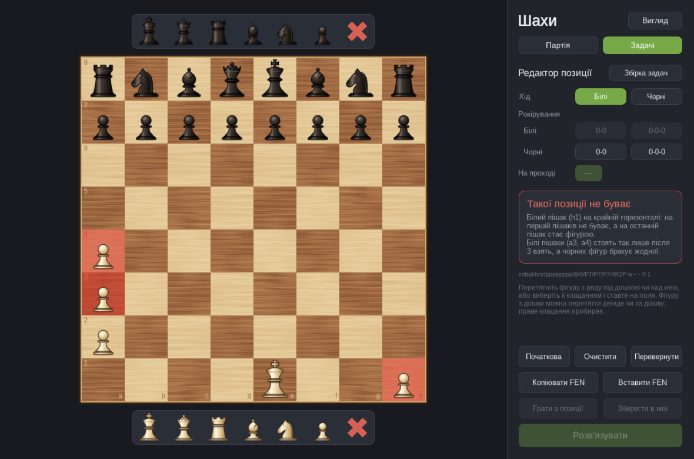

Після кожної зміни гра каже, чи могла така позиція виникнути в партії, а поля,
через які не могла, червоніють:

- немає короля (позицію ще не закінчено), більше одного короля;
- пішак на першій чи останній горизонталі;
- королі поруч; під шахом той, хто щойно ходив;
- шах, якого не міг дати жоден хід: від трьох фігур, від двох «прямих» (пішак,
  кінь — їхній шах не можна відкрити), від пішака, що ще стоїть на своєму
  першому полі;
- більше восьми пішаків; фігур більше, ніж дозволяють перетворення (кожна понад
  комплект — це пішак, якого вже немає); слони рахуються за кольором полів, а
  слон, замкнений власними пішаками, що ще не ходили (c1 за b2 і d2), іншого
  місця, крім рідного, мати не може;
- пішаки стоять так, що для цього треба більше взять, ніж у суперника бракує
  фігур (пішак переходить на іншу вертикаль лише взяттям — найменша кількість
  рахується як задача про призначення);
- поле взяття на проході не узгоджується з шахом.

Це перевірки, якими користуються укладачі задач і арбітри, без повного
ретроаналізу: позиція, що їх пройшла, ще може бути недосяжною якимось тонким
чином, а та, що не пройшла, — недосяжна напевно. Коли позиція можлива, Stockfish
її вивчає й пише, що знайшов: «Білі ставлять мат у 3 ходи» (найкоротший мат,
до восьми ходів) або оцінку.

Звідти три шляхи: «Розв'язувати», «Грати з позиції» (вікно «Нова гра», і з цієї
позиції починається партія проти комп'ютера чи вдвох) і «Зберегти в мої».

**Розв'язування.** Задача — це позиція й мета: мат у стільки-то ходів або, якщо
форсованого мату немає, найкращий хід. Розв'язку задача не містить: кожен ваш
хід перевіряє Stockfish (чи лишається після нього мат у ходи, що залишилися), і
на правильний відповідає найупертішим захистом; неправильний позначається `?` і
забирається. Тому годиться будь-який хід, що справді матує вчасно, — і той, якого
укладач не передбачив. Є підказка (стрілка на ключовий хід), «Розв'язок» (рушій
розігрує його сам), хід назад, «Спочатку» і «Змінити позицію» — у редактор.

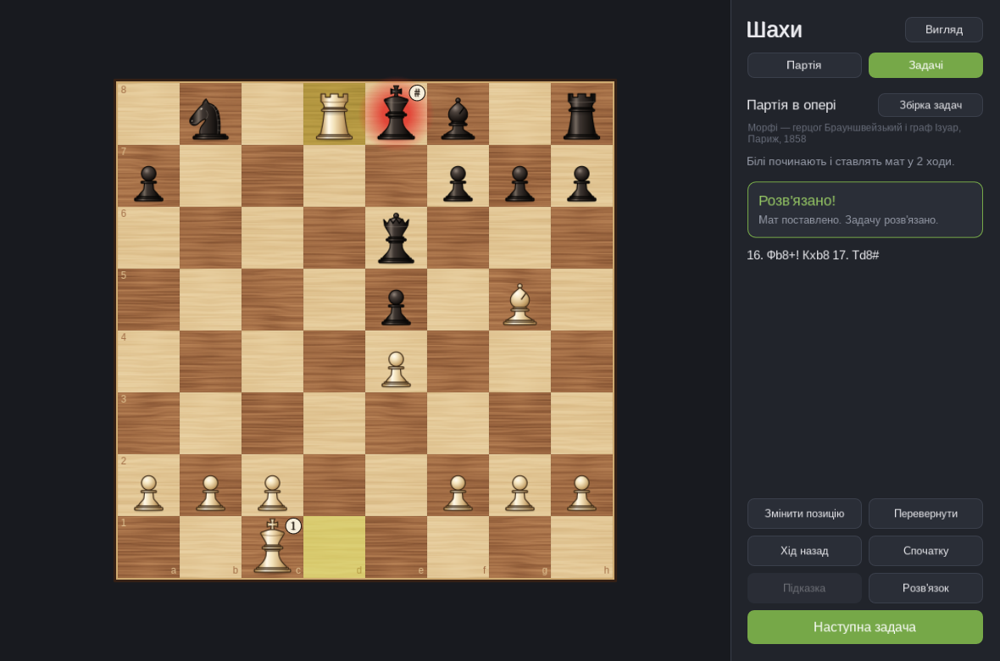

«Збірка задач» — 23 задачі: мати в один хід на відомі візерунки (спертий,
арабський, Анастасії, Бодена, еполетний, дитячий, дурний…), у два (задача Морфі,
«Партія в опері», мат Легаля…), у три–п'ять («Безсмертна партія», мат Філідора…)
і «Мої задачі». Кожну перевірено Stockfish: мат рівно в стільки ходів, і, крім
«Двох тур», лише один перший хід. Розв'язані власноруч (без підказки й без
розв'язку) позначаються галочкою; «Наступна задача» веде до першої
нерозв'язаної.

### Вигляд

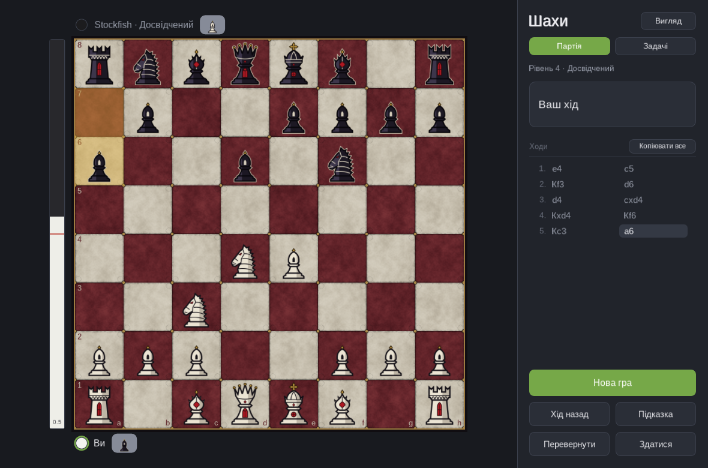

Кнопка «Вигляд» угорі панелі (або `V`) відкриває вибір фігур і дошки. Вони
обираються окремо, тож будь-який набір стоїть на будь-якій дошці. Вибір діє
одразу — посеред партії теж, нічого не перезапускаючи, — і запам'ятовується до
наступного запуску. У самому вікні стрілки `←` `→` гортають дошки, `↑` `↓` —
фігури, `Enter` або `Esc` закриває.

| Фігури | |
|---|---|
| Класичні | стаунтонівські фігури з токарного верстата: самшит і ебен, зі світлом і тінню |
| Діаграмні | фігури з шахової книжки: пласкі, чорно-білі, лише контур і кілька ліній усередині |
| Ґотичні | кістка і чорнило: шпилі, стрілчасті арки, вітражі, зубці «ластівчин хвіст» |
| Аніме | ті самі шість класичних силуетів, намальовані як у мультфільмі: пласкі кольори, біла обвідка, і в кожної фігури своє обличчя |
| Кістяні | точена кість, як у наборах до Стаунтона: одна сторона світла, друга фарбована в червоне; пожовкла й потріскана |
| Старовинні | чатуранга, давньоіндійське військо: цар під парасолем, радник, колісниця, слон, вершник, піхотинець; слонова кістка проти почорнілого дерева |
| Піксельні | піксель-арт: фігури на сітці 32 × 32, п'ять тонів на сторону й темний контур |

| Дошка | |
|---|---|
| Дерево | клен і горіх: кожне поле — свій шматок шпону, темна рама зі світлою ниткою |
| Ґотика | церковна долівка: вапняк і бордо, стерті плити, чотирилисник із латунним цвяхом на стиках |
| Мармур | холодний сірий |
| Смарагд | зелене сукно турнірної зали |
| Сакура | кремове й рожеве, пласке, як кадр мультфільму, з опалими пелюстками |
| Шкіра | стара тиснена дошка: пергамент і темна шкіра, кожне поле обведене лінією, з плямами й тріщинами |
| Камінь | плити світлого й червоного пісковику, вищерблені й побиті часом |
| Пікселі | піксельні плитки 32 × 32, кремові й зелені, на тій самій сітці, що й піксельні фігури |

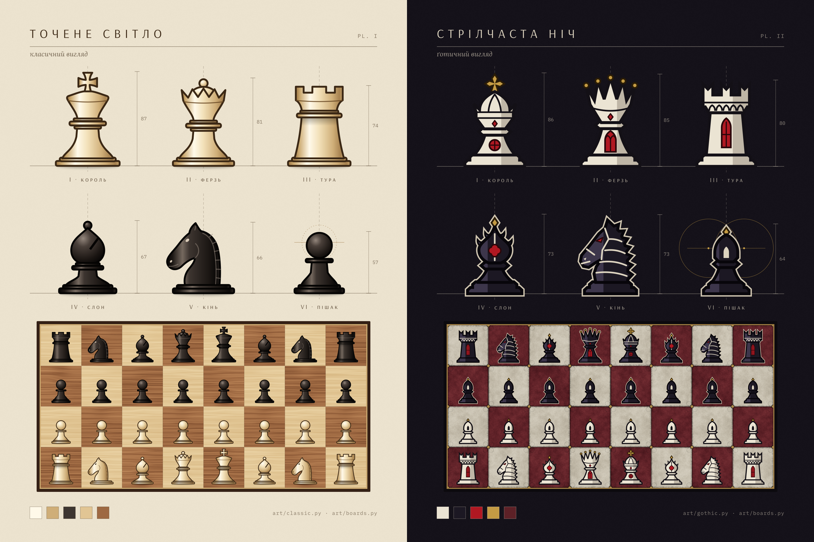

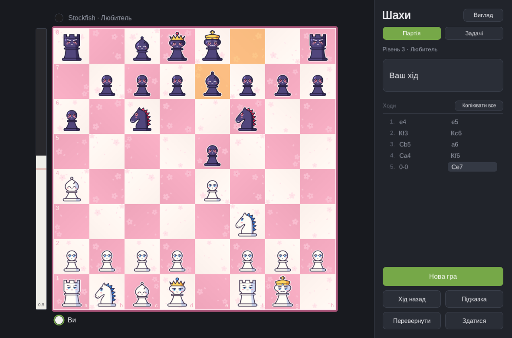

Аніме-набір — це передусім шахові фігури: куля пішака, зубці тури, голова
коня, митра слона з прорізом, корона ферзя з вістрями, корона й хрест короля.
Аніме в ньому — манера: пласкі кольори з однією твердою тінню, біла обвідка,
як у наліпки, і обличчя, у кожної фігури своє. Пішак витріщає очі, кінь
задоволений собою, слон усміхається із заплющеними очима, тура насуплена,
ферзь — з віями, король — спокійний і з вусиками. Світлі — кремові з синіми
очима, темні — фіолетові з червоними; корони золоті в обох.

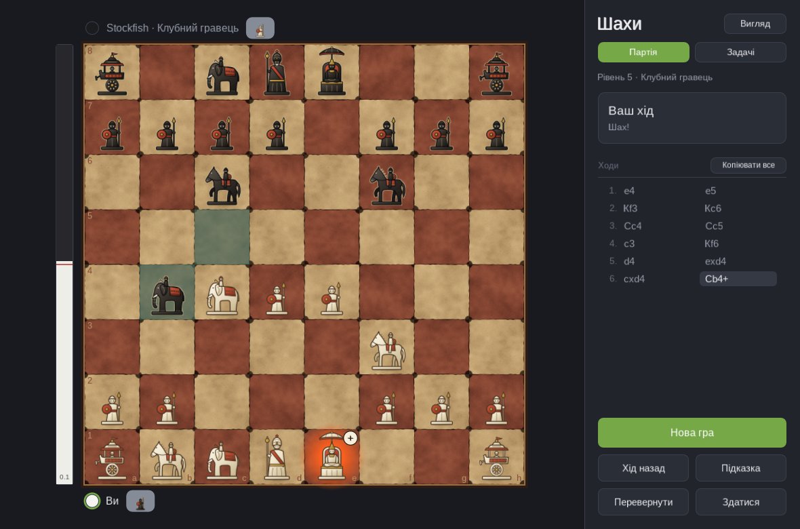

Старовинний набір — це шахи до того, як вони стали шахами: чатуранга, гра
про чотири роди давньоіндійського війська й царя, за якого вони б'ються.
Фігури і є цим військом:

| Фігура | У чатуранзі | Як намальована |
|---|---|---|
| король | раджа, цар | сидить, схрестивши ноги, на троні під царським парасолем |
| ферзь | мантрі, радник | високий чоловік у довгому вбранні й тюрбані, з жезлом |
| тура | ратха, колісниця | бойова колісниця: велике колесо, кузов і ярусний дах із прапорцем |
| слон | ґаджа, слон | слон із погоничем на шиї |
| кінь | ашва, кіннота | кінь із вершником |
| пішак | падаті, піхотинець | воїн зі щитом і списом |

Ходять вони як звичайні шахові фігури — змінено лише вигляд. Одна сторона зі
слонової кістки, друга з почорнілого дерева; на обох рештки фарби — червона
вохра на тканині й щитах, трохи золота на коронах. Темні фігури світло витерті
по краях, тож не зливаються навіть із темним полем. Розмір тут — це ранг, як
у давньому різьбленні, де важливіший більший, і йде він у тому ж порядку, що й
цінність: піхотинець, вершник і слон, колісниця, радник, цар.

Кам'яна дошка червона, тому позначки на ній інших кольорів: останній хід
зеленавий, вибране поле жовте, шах жаро-помаранчевий.

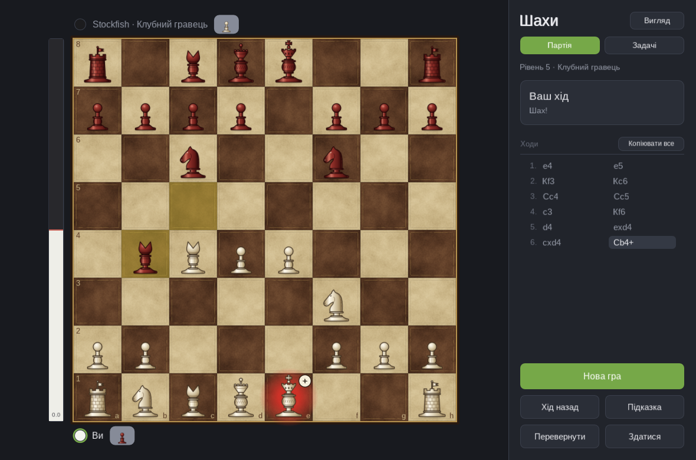

Кістяний набір — такий, який стояв на столах до Стаунтона: точена кість,
одна сторона свого кольору, друга фарбована в червоне (червоні тут грають за
чорних). Фігура — низка намистин: куполоподібна основа, кільце, шийка, барильце,
комір, а зверху те, чим вона є. У короля ажурна галерея й хрест, у ферзя вінець
із кульок, тура — цегляна вежа з прапорцем, митра слона розділена на два роги,
кінь — маленька різьблена голова на п'єдесталі, пішак — куля на балясині. Кість
пожовкла, потріскалася вздовж волокна, а в стиках осів бруд.

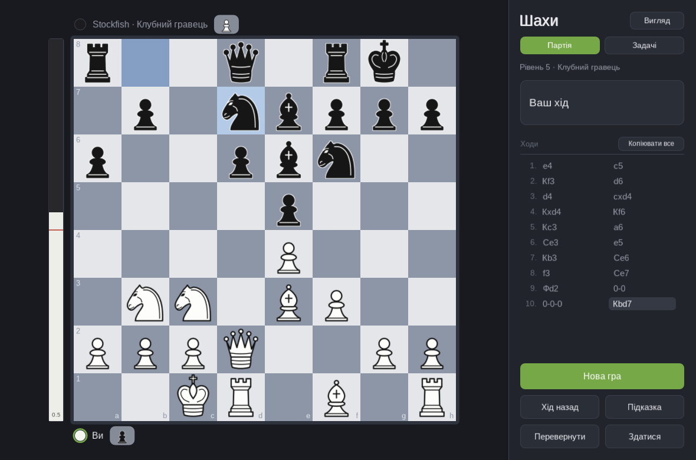

Діаграмний набір — це фігури, якими позицію друкують у книжці: пласкі, без
об'єму й тіні, білі — папір у чорнильному контурі, чорні — суцільне чорнило з
тими самими лініями, лишеними білими. Сама ця манера стара, як шахові книжки,
і нічия; контури намальовано для цієї гри з нуля, жодного наявного набору чи
шрифту не обведено. Чорні фігури мають тонку світлу облямівку, тож не
зливаються й з темним полем.

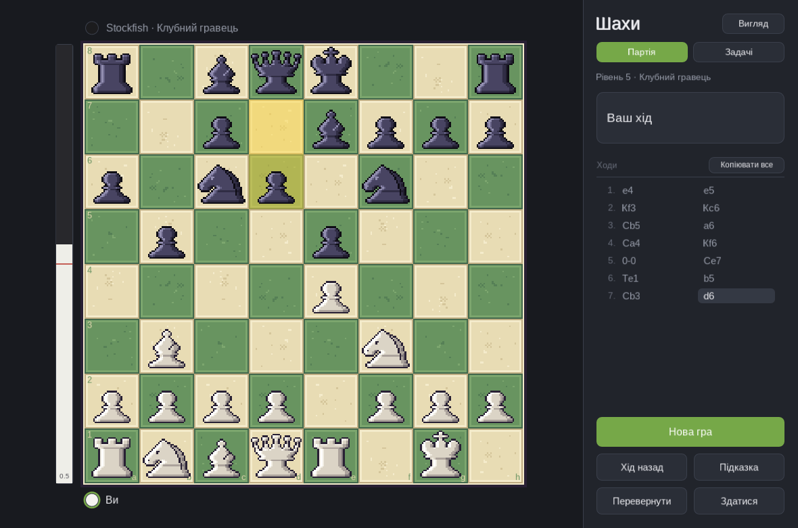

Піксельний набір — фігури, якими їх намалювала б стара ігрова приставка: сітка
32 × 32, п'ять тонів на сторону й один темний контур. Силуети звичайні шахові:
куля пішака, зубці тури, голова коня, митра з прорізом, корона ферзя з
кульками на вістрях, корона й хрест короля. Дошка «Пікселі» намальована на тій
самій сітці, тож піксель фігури й піксель поля під нею однакові завбільшки й
лежать на одних лініях. Світлі фігури кремові, темні — сіро-фіолетові, поля —
кремові й зелені, тож ні ті, ні ті з дошкою не зливаються. Картинки гра
зменшує до розміру поля згладжено, як і всі інші, тому на малому вікні пікселі
трохи м'якші, а найчіткіші — на великому вікні чи екрані Retina.

У всіх семи наборах розмір фігури йде за її цінністю: пішак найменший, кінь і
слон однакові, тура вища за них, далі ферзь і король. (Тому тура тут вища за
слона, хоч у справжньому стаунтонівському комплекті вона нижча.)

Кожен набір стоїть на будь-якій дошці:

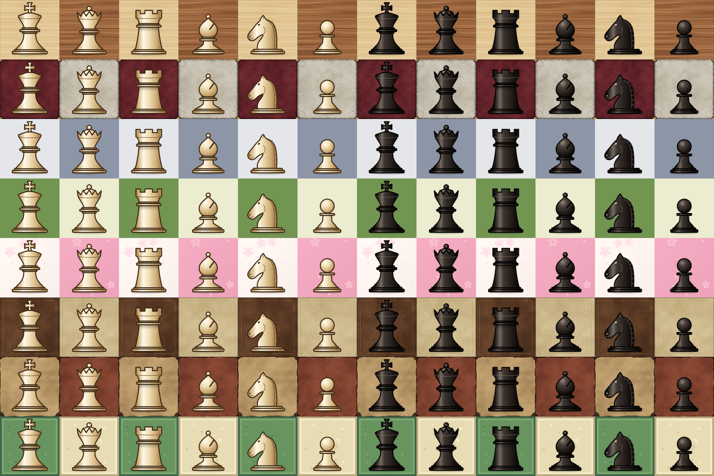
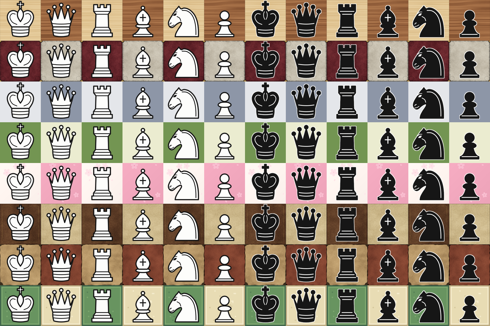
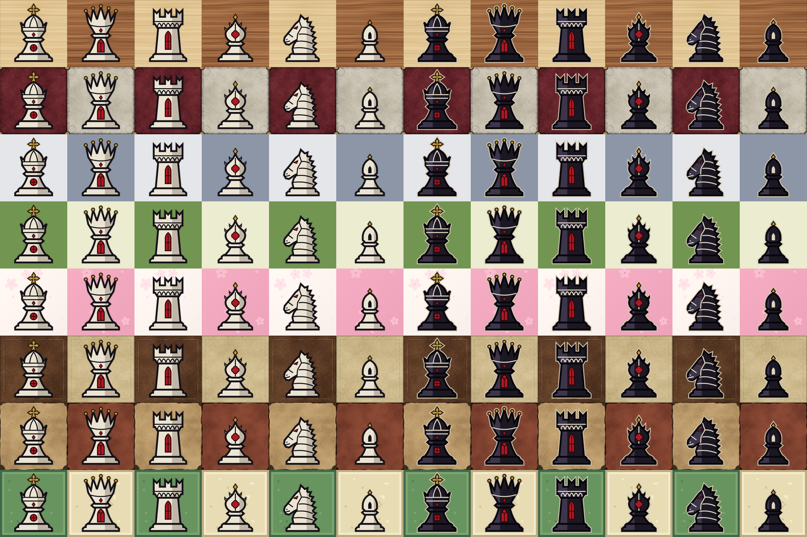
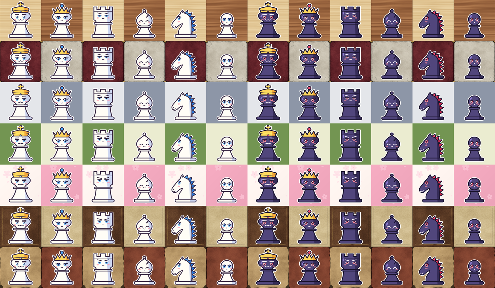
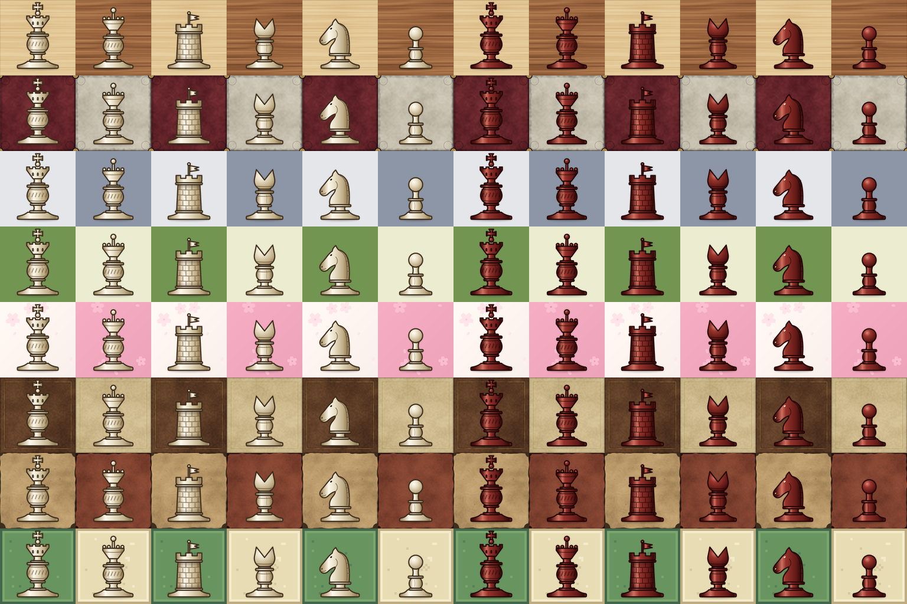
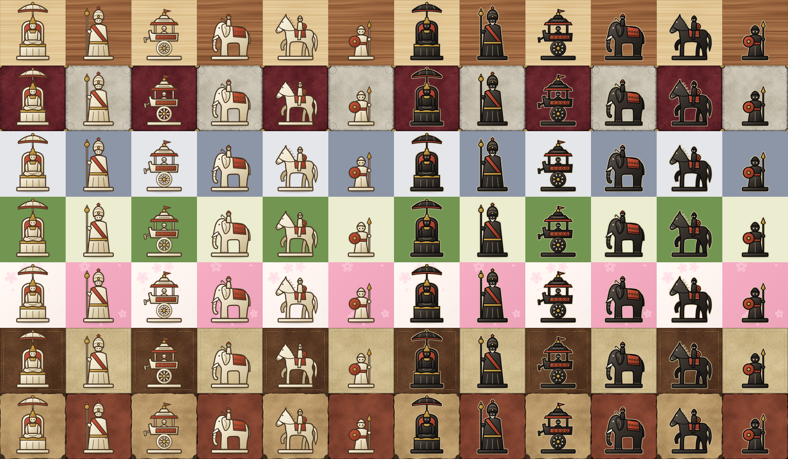
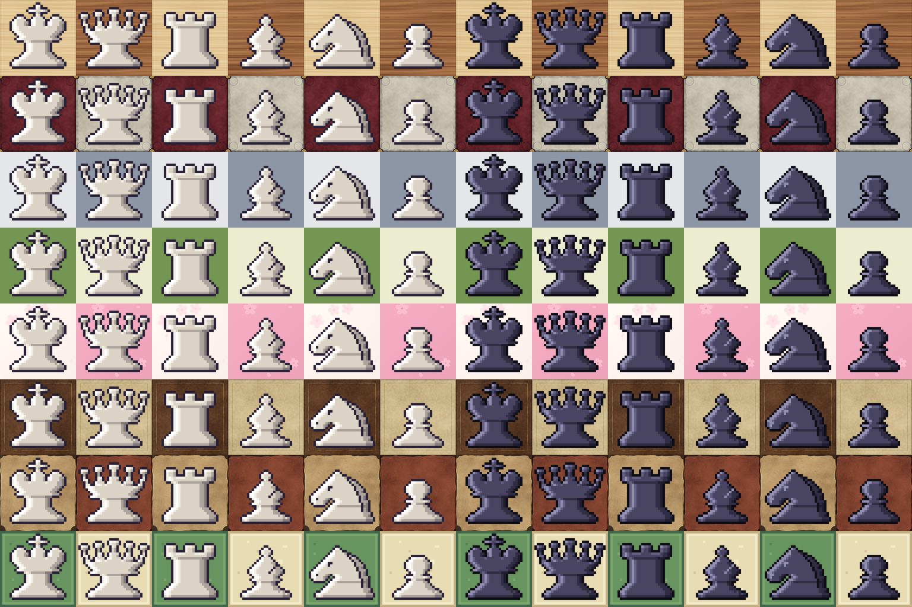

Позначки на дошці — останній хід, виділене поле, куди можна піти, шах — у
кожної дошки свої: зелене виділення загубилося б на бордо, а червоний шах на
бордо не був би попередженням.

Усі сім наборів і шість дощок із малюнком намальовані для цієї гри, і все
це — код у теці `art/`. Набір — один файл (`art/classic.py`, `art/diagram.py`,
`art/gothic.py`, `art/anime.py`, `art/bone.py`, `art/ancient.py`): дванадцять фігур описано контурами на
квадраті 100 × 100, і він пише з них SVG (`art/<набір>/`) та PNG, які
завантажує гра. Піксельний набір (`art/pixel.py`) описано інакше: тіло кожної
фігури — рядок за рядком на сітці 32 × 32, а контур і світло скрипт
вираховує сам. Щось змінити — поправити число й запустити
`python3 art/gothic.py --sheet` (потрібні `rsvg-convert` і Pillow). Поля дощок
«Дерево», «Ґотика», «Сакура», «Шкіра», «Камінь» і «Пікселі» робить
`art/boards.py` (потрібен ще numpy): по дві картинки на дошку, у кожній чотири
різні поля, і гра кладе їх так, щоб сусідні не повторювалися. Спільне для всіх
— `art/kit.py`; думка, з якої все намальовано, — `art/DESIGN.md`; аркуш вище
малює `art/plate.py`.

Додати власне: набір фігур — це тека з дванадцятьма PNG (`wK.png` … `bP.png`) у
`game/Content/pieces/` і рядок у таблиці в `game/Source/Look.cpp`; дошка — рядок
у сусідній таблиці і, якщо вона не просто двох кольорів, тека з `light.png` і
`dark.png` у `game/Content/boards/`. Кнопки у вікні «Вигляд» з'являться самі.

### Шкала оцінки

Ліворуч від дошки — оцінка позиції: смужка наполовину біла, коли гра рівна, і
заповнюється кольором того, хто стоїть краще. Число на кінці переможця — перевага
в пішаках (`1.3`), або `#4` — мат за чотири ходи. Після кінця партії там
результат.

Оцінку дає другий примірник Stockfish, який у грі участі не бере: він дивиться
на кожну позицію на повній силі, хоч би на якому рівні грав суперник. Звідти ж
береться й підказка — це хід, який зробив би він. Шкала рухається одразу й
уточнюється до секунди; заокруглення таке, як заведено на шахових сайтах: пішак
переваги — це близько 59% смужки, три — 75%, п'ять — 86%.

### Оцінки ходів

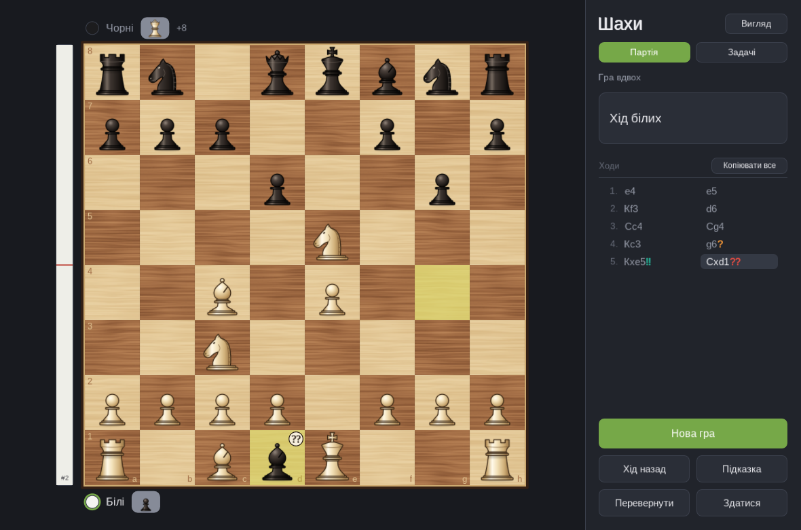

Після ходу в списку може з'явитися знак, а на дошці — кружечок із ним на полі,
куди пішла фігура. Усі позначки на дошці зроблено по-книжковому: кружечок
кольору паперу з тонким чорнильним обідком і знак шрифтом із зарубками — без
малюнків і без кольорів, тільки шахова нотація. (У списку ходів знаки
лишаються кольоровими.)

| Знак | Що означає | Коли ставиться |
|---|---|---|
| `!!` | блискучий хід | жертва, яка працює: хід лишає під боєм матеріал щонайменше на два пішаки, він не гірший за найкращий, і без нього партію не було виграно |
| `!` | сильний хід | єдиний добрий хід, який треба було знайти: наступний за силою гірший щонайменше на 10% шансів |
| `?!` | неточність | хід віддав від 5% шансів на перемогу |
| `?` | помилка | від 10% |
| `??` | груба помилка | від 15% |

Stockfish ходів не оцінює — він оцінює позиції. Знак виходить із порівняння
двох його оцінок: чого позиція була варта до ходу (тобто з найкращим ходом) і
чого стала варта після зробленого. Різниця рахується не в пішаках, а в шансах
на перемогу — за тією самою кривою, що й шкала: пішак, утрачений у рівній
позиції, важить багато, а за зайвого ферзя — нічого. Пороги для `?!`, `?`, `??`
ті самі, що на lichess. Хід, який сам рушій назвав найкращим, поганого знака не
дістає ніколи.

`!` не дістається вимушеному ходу, хоч би наскільки він був єдиним: не
позначаються взяття, що просто виграє матеріал, взяття у відповідь, відхід від
шаху і порятунок фігури, яка стояла під боєм.

Знаки ставляться обом сторонам і з'являються за мить після ходу: для кожного
потрібні дві оцінені позиції. Якщо гра пішла далі швидше, ніж рушій устиг
подивитися (на нижчих рівнях суперник відповідає за частку секунди), він
повертається до пропущених позицій, щойно звільниться, — від останніх до
перших. Знаки потрапляють і в скопійовану партію (`Nxe5!!`), і в скопійований
хід.

Варто пам'ятати, що це знаки рушія на невеликій глибині, а не коментатора:
`!!` означає «жертва, і вона коректна», а не «красиво».

### Знаки на королях

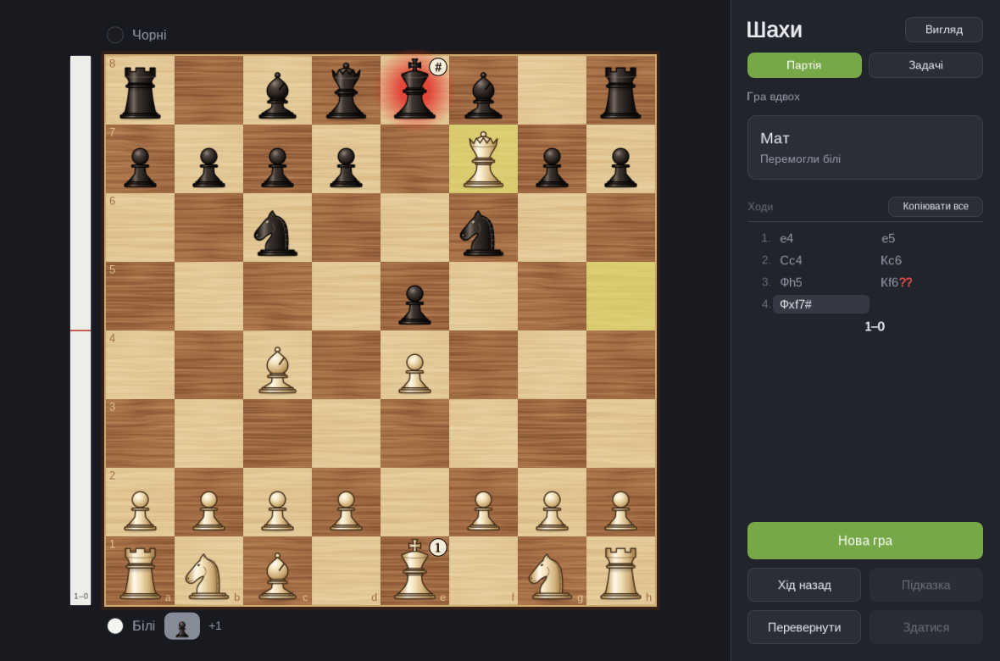

Як стоїть партія, видно й на самій дошці — такий самий кружечок у кутку поля,
але на королі:

| Знак | На кому | Що означає |
|---|---|---|
| `+` | король під шахом | шах |
| `#` | король, якому поставили мат | мат |
| `1` | король переможця | перемога — матом або через здачу суперника |
| `0` | король того, хто здався | здача |
| `½` | обидва королі | нічия: пат, триразове повторення, 50 ходів, нестача матеріалу |

Це ті самі знаки, якими партію записують на бланку: `1` і `0` на королях
складаються в рахунок `1–0` чи `0–1`, два `½` — у `½–½`. Яка саме нічия,
написано на панелі праворуч. Коли партію закінчено, під
останнім ходом у списку з'являється рахунок: `1–0`, `0–1` або `½–½`. Якщо
останній хід зроблено королем і в нього є власна оцінка, вона стає в лівому
кутку поля, а знак партії — у правому.

### Рівні складності

Stockfish на повній силі не програє нікому, тож складність — це те, наскільки
його стримано. Рушій сам уміє грати на заданий рейтинг (`UCI_LimitStrength` /
`UCI_Elo`), але його нижня межа — близько 1320 Elo, а це вже впевнений
любитель. Нижче за неї гра додає власний гандикап: частину ходів робить не
рушій, а випадок.

| № | Назва | Як грає | Час на хід |
|---|---|---|---|
| 1 | Початківець | 1320 Elo, 35% ходів випадкові | 0,15 с |
| 2 | Новачок | 1320 Elo, 15% ходів випадкові | 0,2 с |
| 3 | Любитель | 1320 Elo | 0,3 с |
| 4 | Досвідчений | 1600 Elo | 0,4 с |
| 5 | Клубний гравець | 1900 Elo | 0,5 с |
| 6 | Кандидат у майстри | 2200 Elo | 0,7 с |
| 7 | Гросмейстер | 2600 Elo | 1 с |
| 8 | Без обмежень | повна сила, до 4 потоків | 2 с |

Рейтинги — це те, що просять у Stockfish, а не виміряна сила проти людей.
Таблиця живе в одному місці — `engine/uci/src/Difficulty.cpp`.

#### Між рівнями

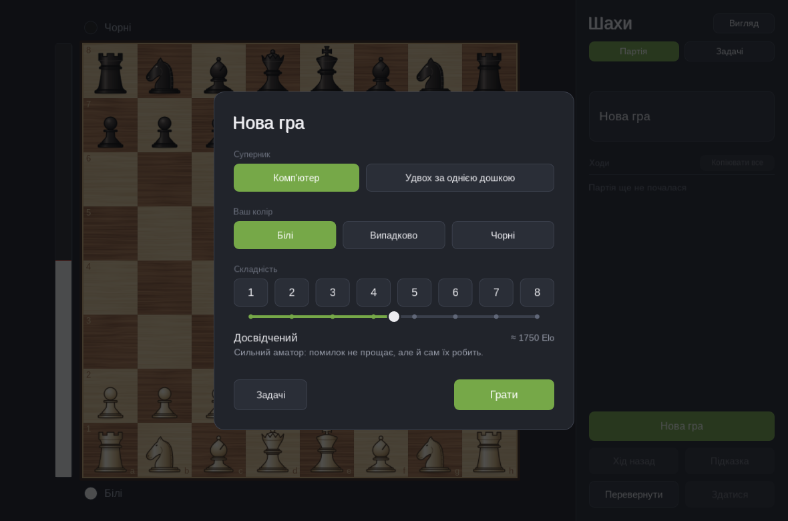

Вісім кроків — це мало: один рівень буває заслабким, а наступний уже засильним.
Тому рівні — лише зупинки на довшій шкалі, і під кнопками рівнів у вікні «Нова
гра» є повзунок, який проходить її всю, 224 положення:

- від рівня 1 до рівня 3 — дедалі менше випадкових ходів: від 35 % до жодного,
  на один зі ста менше за крок;
- від рівня 3 до 3190 Elo, стелі `UCI_Elo` у Stockfish, — рейтинг, по 10 Elo
  за крок;
- останній крок — без обмежень.

Час на хід росте рівномірно від рівня до рівня: на 1750 Elo, посередині між
четвертим і п'ятим, це 0,45 с.

Повзунок можна тягти, клацнути будь-де на ньому або рухати стрілками `←` і `→`
по одному кроку. Позначки на ньому стоять під кнопками своїх рівнів, тож між
сусідніми позначками відстань однакова, а кроків різна кількість: де їх
більше, там кожен дрібніший під вказівником. Кнопка рівня світиться, лише коли
вибрано саме цей рівень; над описом написано назву рівня, якого вже досягнуто,
і що саме вибрано — частку випадкових ходів, рейтинг або «повна сила». Під час
партії на панелі те саме: «Рівень 4 · Досвідчений» для рівня,
«Досвідчений · ≈ 1750 Elo» для сили між двома. У PGN суперник між рівнями
записується як `Stockfish, 1750 Elo`.

Варто знати, *як* Stockfish грає слабше, бо це видно за дошкою. Він не «думає
гірше»: на невеликій глибині (що нижчий рейтинг, то меншій — на 1320 це один
півхід) він бере чотири найкращі на його погляд ходи й вибирає серед них
жеребом, зваженим на те, наскільки хід гірший за перший. Два наслідки:

- Помилки приходять стрибками. Суперник може десять ходів грати пристойно, а
  тоді віддати фігуру за двоходівку, якої на своїй глибині не бачив. На шкалі
  оцінки це видно одразу.
- В одній і тій самій позиції він щоразу може зіграти інакше. Тому гра
  запам'ятовує його відповіді в межах партії: інакше «хід назад» і той самий
  хід удруге були б способом перекинути кубик, і суперник то знаходив би
  спростування, то ні.

## Як це влаштовано

```
engine/rules/                 правила шахів; нічого, крім стандартної бібліотеки
  include/chess/Types.h       кольори, фігури, поля, хід
  include/chess/Position.h    позиція: FEN, дозволені ходи, шах, нотація
  include/chess/Game.h        партія: історія, хід назад, чим скінчилося, запис у PGN
  include/chess/Judge.h       оцінка ходу (!!, !, ?!, ?, ??) за двома оцінками позиції
  include/chess/Setup.h       розстановка з редактора: будь-яка, і чому вона (не)можлива
  src/Board.h                 спільне для Position і Setup: кроки фігур, розбір FEN
  tests/                      perft, FEN, нотація, нічиї, відомі партії, можливість позицій
engine/uci/                   розмова з рушієм; про правила не знає
  include/chess/Process.h     дочірній процес із двома каналами
  include/chess/Engine.h      UCI: запит ходу, скасування, відповідь пізніше
  include/chess/Difficulty.h  рівні складності і шкала між ними
  tests/                      несправжній рушій (sh) і справжній Stockfish
engine/session/               режими гри без екрана: правила + запитання до рушія
  include/chess/PuzzleSession.h  задача: хід, перевірка, відповідь захисту, підказка, розв'язок
  include/chess/GameReview.h  що рушій знайшов про позиції партії, і знаки ходів звідти
  tests/                      кожен перехід — без вікна й без справжнього рушія
game/                         застосунок на axmol
  Source/AppDelegate.*        вікно, параметри командного рядка, головний цикл
  Source/GameScene.*          партія: зводить докупи правила, рушій і екран
  Source/BoardNode.*          дошка, фігури, позначки, перетягування
  Source/BoardInput.*         хід мишею: вибір, клік-клік, перетягування, промоція — для обох режимів
  Source/EvalBar.*            шкала оцінки
  Source/Panels.*             смужки гравців і панель праворуч
  Source/Look.*               набори фігур і дошки: таблиці, поточний вибір, малювання дошки
  Source/Dialog.h             спільне для двох вікон
  Source/NewGameDialog.*      вікно «Нова гра»
  Source/LookDialog.*         вікно «Вигляд»
  Source/ConfirmDialog.*      «Партію не закінчено»: запитання перед її втратою
  Source/PuzzleScene.*        режим «Задачі»: редактор позиції; розв'язування малює з PuzzleSession
  Source/PuzzlePanel.*        його панель праворуч: дві сторінки
  Source/PieceTray.*          ряди фігур над дошкою й під нею
  Source/PuzzleDialog.*       вікно «Збірка задач»
  Source/Puzzles.*            збірка задач і власні задачі гравця
  Source/Button.*             кнопка і набір кнопок
  Source/Slider.*             повзунок із позначками (складність)
  Source/Shapes.*             згладжені фігури поверх DrawNode
  Source/Text.*               написи й перенесення рядків
  Source/Desktop.*            буфер обміну і знімок вікна (--shot)
  Source/EventLog.h           журнал подій для перевірок (CHESS_EVENT_LOG=1)
  Source/Wakefulness.*        засинання: без причини не спати — жодного кадру (CHESS_IDLE_LOG=1)
  Source/Strings.*            увесь текст гри
  Source/Theme.h              кольори інтерфейсу навколо дошки
  Content/pieces/classic/     класичні фігури (PNG)
  Content/pieces/diagram/     діаграмні фігури (PNG)
  Content/pieces/gothic/      ґотичні фігури (PNG)
  Content/pieces/anime/       аніме-фігури (PNG)
  Content/pieces/bone/        кістяні фігури (PNG)
  Content/pieces/ancient/     старовинні фігури, чатуранга (PNG)
  Content/pieces/pixel/       піксельні фігури (PNG)
  Content/boards/wood/        поля дошки «Дерево» (PNG)
  Content/boards/gothic/      поля дошки «Ґотика» (PNG)
  Content/boards/sakura/      поля дошки «Сакура» (PNG)
  Content/boards/leather/     поля дошки «Шкіра» (PNG)
  Content/boards/stone/       поля дошки «Камінь» (PNG)
  Content/boards/pixel/       поля дошки «Пікселі» (PNG)
  cmake/modules/              шаблон гри з axmol 2.9.1
  proj.ios_mac/, proj.linux/  точки входу для macOS і Linux
art/classic.py                класичний набір: звідси беруться SVG і PNG
art/diagram.py                діаграмний набір: так само
art/gothic.py                 ґотичний набір: так само
art/anime.py                  набір «Аніме»: так само
art/bone.py                   кістяний набір: так само
art/ancient.py                старовинний набір (чатуранга): так само
art/pixel.py                  піксельний набір: сітка 32 × 32, контур і світло вираховуються
art/classic/, art/diagram/, art/gothic/, art/anime/, art/bone/, art/ancient/, art/pixel/   їхні SVG
art/boards.py                 поля дощок «Дерево», «Ґотика», «Сакура», «Шкіра», «Камінь» і «Пікселі»
art/kit.py                    спільне для них: контури, рендер, оглядовий аркуш
art/plate.py                  аркуш docs/looks.png
art/DESIGN.md                 сім виглядів — сім шкіл: з чого все намальовано
cmake/Chess.cmake             залежності, підготовка axmol, збірка Stockfish
tools/ui-checks/run.sh        гра під уявною мишею: перевірки поведінки (Linux)
docs/                         знімки екрана й джерело значка
third-party/axmol/            axmol v2.9.1 (MIT)
third-party/Stockfish/        Stockfish, тег stockfish-dev-20260930-49ea5ded (GPLv3)
third-party/googletest/       googletest, main від 2026-10-02 (BSD-3-Clause), лише тести
```

Три частини не знають одна про одну. Правила нічого не чули про рушій і вікна.
Клієнт рушія не знає правил: ходи перетинають його межу як текст UCI (`e2e4`).
Вузли на екрані показують те, що їм сказали. Усе це зустрічається в одному
місці — `GameScene`.

**Stockfish — окремий процес, і їх два.** Гра запускає його й розмовляє з ним
через stdin/stdout, як будь-який шаховий інтерфейс. Один примірник — суперник,
стриманий до вибраного рівня. Другий лише дивиться: оцінює кожну позицію на
повній силі для шкали, підказки й оцінок ходів (тому повідомляє два найкращі
ходи, а не один). Вони розведені навмисно — гандикап суперника
не потрапляє в оцінку, а прохання про підказку нічого не змінює в тому, як
суперник грає. (Сама нейромережа, сто мегабайтів, у пам'яті одна на обох.)

Нічого не блокується: `search()` повертається одразу, окремий потік читає
відповіді, а головний раз на кадр забирає готовий хід і дивиться, що рушій
думає просто зараз (`progress()`). Нове запитання скасовує попереднє — тому
«хід назад» посеред роздумів рушія не лишає відповіді, яка прийшла б у вже іншу
позицію. Рушієві щоразу передається вся партія (`position startpos moves …`),
тож повторення позицій він рахує сам.

Шукають його так: змінна `CHESS_ENGINE`, далі `stockfish` поруч із виконуваним
файлом, далі шлях, який знайшла збірка, далі `PATH`. Якщо рушія немає, гра
працює в режимі «вдвох»; якщо він упав посеред партії, вона про це каже й
запускає його знову з новою грою. `CHESS_UCI_LOG=1` друкує обидві розмови у
stderr: рядки `uci` — суперник, `eval` — той, що дивиться.

**Режим «Задачі» — окрема сцена поверх партії** (`pushScene`/`popScene`): партія
з обома своїми рушіями чекає під нею незмінна. У задач свій, третій, Stockfish.
Він працює в один потік: з кількома Stockfish іноді закінчує пошук, обмежений
одним ходом (`go mate N searchmoves …`), за кілька півходів і без мату, який
знайшов би, — а саме таким пошуком перевіряється хід гравця. Якщо мату з боку
нападу не знайдено, перш ніж сказати «ні», рушія питають ще й з боку захисту:
чи отримує він мат у ходи, що залишилися.

**Правила — масив 8×8, а не бітборди.** Ця бібліотека відповідає на запитання
людини за дошкою кілька десятків разів на секунду щонайбільше; думати — робота
Stockfish. Правильність перевіряє perft: кількість позицій, досяжних за N
півходів, звіряється з відомими числами для шести позицій, підібраних саме під
рокіровки, взяття на проході, зв'язки й перетворення.

**Згладжування своє.** Шейдер `DrawNode` в axmol ріже край фігури сходинкою, а
мультисемплінг залежить від графічного бекенда. Тому кожне коло й кожен
заокруглений прямокутник у `Shapes.cpp` малюється суцільним тілом і піксельною
облямівкою, що згасає до прозорого, — однаково на OpenGL і Metal.

**Немає дій — немає навантаження.** За пів секунди тиші гра зупиняє кадри
(`Director::stopAnimation()`), а головний цикл перестає опитувати систему й
чекає на неї: `glfwWaitEvents()` повертається лише тоді, коли для вікна щось є —
клавіша, миша, зміна розміру, закриття. Процес у цей час заблокований у ядрі й
не прокидається жодного разу; обидва Stockfish так само чекають на рядок у
своєму вході. Виміряно: на Linux 0 пробуджень за секунду проти 60 у штатному
циклі axmol; на macOS «Монітор активності» показує 0,0% CPU і 0 Idle Wake Ups.

Цикл свій (`AppDelegate::runUntilClosed`), бо `Application::run()` в axmol —
ігровий: 60 разів на секунду викликає `pollEvents()` і засинає до наступного
кадру, навіть коли кадрів немає. Рух миші над вікном гру теж не будить, якщо
нічого не змінює: малювати є що лише тоді, коли вказівник заходить на кнопку,
сходить із неї або несе фігуру.

Єдине, що не приходить через вікно, — відповідь рушія: вона з'являється в
іншому потоці й забирається в `update()`, а той працює лише поки йдуть кадри.
Тому гра не засинає, поки їй щось винні: хід суперника, аналіз позиції (і
повернення до пропущених), рух шкали чи фігури. `CHESS_IDLE_LOG=1` друкує у stderr, що саме зараз не дає їй
заснути і коли вона заснула. Таймер і журнал — у `Wakefulness`, спільному для
обох режимів; список причин кожна сцена дає свій (у задачах це ще перевірка
позиції в редакторі й пауза перед відповіддю захисту).

## Перевірка

```bash
cmake -S . -B build -DCHESS_BUILD_APP=OFF && cmake --build build -j
ctest --test-dir build --output-on-failure
```

149 тестів. Ті, що грають проти справжнього Stockfish, самі себе пропускають,
якщо бінарника немає; серед них — партії на кожному рівні, де кожен хід рушія
мусить бути дозволеним за нашими правилами.

Те, що робить гравець мишею, перевіряє `tools/ui-checks/run.sh` (лише Linux:
Xvfb, xdotool, ImageMagick). Він запускає зібрану гру у віртуальному дисплеї,
клацає й тягне фігури, а що з того вийшло, читає з журналу подій гри
(`CHESS_EVENT_LOG=1`): чи відповів рушій, чи не зробився хід після «ходу назад»
посеред перетягування, чи засинає гра, чи показує «Розв'язок» розв'язок тощо.

```bash
tools/ui-checks/run.sh build/bin/Chess/Chess            # усі перевірки
tools/ui-checks/run.sh build/bin/Chess/Chess mate_in_one
```

Поля й кнопки він шукає там, де вони у вікні типового розміру (1180 × 780).

Сама гра має кілька параметрів командного рядка, щоб дивитися на неї без миші:

```bash
Chess --play --level 5 --side black     # одразу до дошки
Chess --play --elo 1750                 # сила між рівнями: найближча до цього рейтингу
Chess --fen "8/4P1k1/8/8/8/8/8/7K w - - 0 1" --two-players
Chess --moves "e2e4 e7e5 g1f3"          # зіграти ці ходи й продовжити
Chess --shot board.png                  # дочекатися, поки все вгамується, зберегти кадр у PNG і вийти
Chess --pieces gothic --board marble    # вигляд на цей запуск, не чіпаючи збереженого
Chess --autoplay 5 --level 3            # п'ять партій випадкових ходів проти рушія
Chess --puzzles                         # одразу в режим «Задачі», у редактор
Chess --edit "4k3/8/8/8/8/8/8/4K2R w K -"   # редактор з цією позицією
Chess --puzzle m2-morphy                # задача зі збірки (ідентифікатори — у Puzzles.cpp)
```

`--moves` розуміє і запис UCI (`e2e4`), і звичайну нотацію (`Nf3`, `O-O`).

## Чужа робота

- **Stockfish** — GPLv3. Гра його не лінкує, а запускає як окрему програму.
- **axmol** — MIT.

Усі сім наборів фігур і всі вісім дощок чужої роботи не містять: їх намальовано
для цього проєкту (аніме-набір — це стиль, а не чиїсь персонажі). (Класичним набором раніше був «cburnett» Коліна Бернетта,
GPLv2+; його замінено, він лишився тільки в історії git.)

Задачі збірки — загальновідомі візерунки матів і позиції з партій XIX століття
(Морфі, Андерсен, Легаль, Філідор); розстановки складено й перевірено для гри.

Якщо колись поширюватимете зібраний застосунок, умови GPL стосуються
бінарника Stockfish у бандлі.
