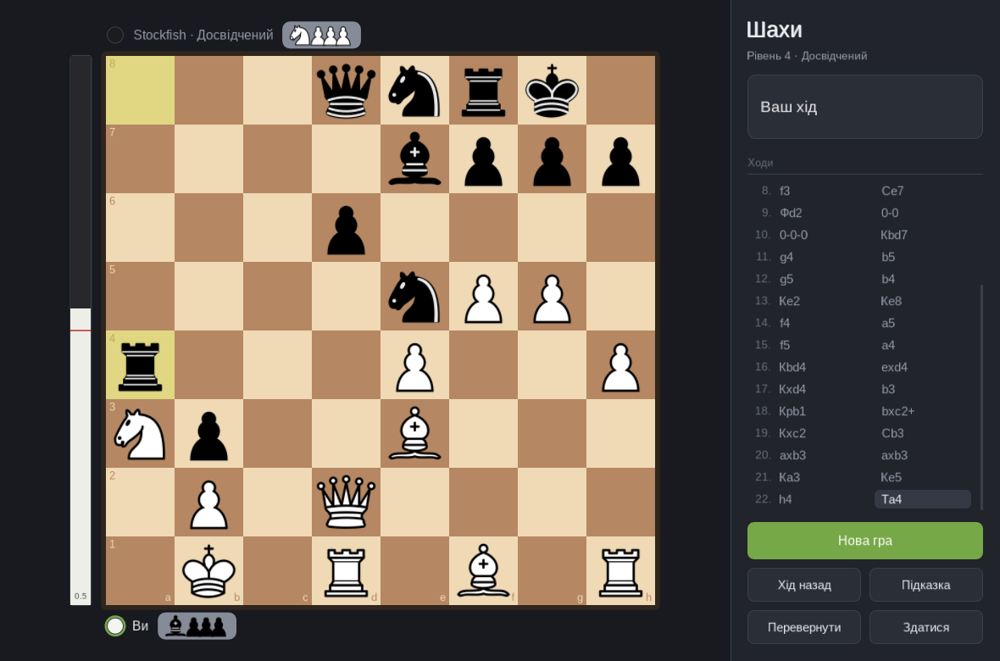
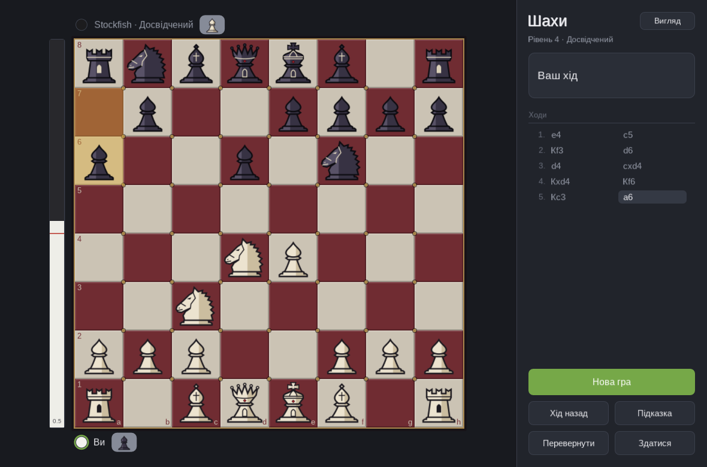
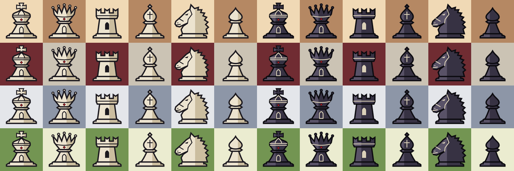

# Шахи

Гра в шахи з графічним інтерфейсом на [axmol](https://axmol.dev/) — тому самому
рушії, що й у Another Life, — і зі [Stockfish](https://stockfishchess.org/) у
ролі суперника.



- гра проти комп'ютера на восьми рівнях складності або вдвох за однією дошкою;
- ходи кліком або перетягуванням, підсвітка дозволених ходів, останнього ходу й шаху;
- усі правила: рокіровка, взяття на проході, перетворення пішака з вибором
  фігури, мат, пат, нічиї за триразовим повторенням, правилом 50 ходів і через
  нестачу матеріалу;
- запис партії українською нотацією, взяті фігури й перевага в матеріалі;
- шкала оцінки ліворуч від дошки: хто стоїть краще й наскільки, за Stockfish;
- хід назад, підказка від рушія на повній силі, перевертання дошки, здача;
- вигляд на вибір: два набори фігур (класичний і ґотичний) і чотири дошки, у
  будь-якому поєднанні;
- вікно тягнеться до будь-якого розміру; коли нічого не відбувається, гра не
  малює взагалі й не навантажує процесор.

## Збірка

```bash
cmake -S . -B build -DCMAKE_BUILD_TYPE=Release
cmake --build build -j                  # правила, тести і гра
ctest --test-dir build --output-on-failure
cmake --build build --target run        # запустити гру
```

Нічого, крім CMake, git і PowerShell (його вимагають скрипти збірки axmol),
готувати не треба. Усе, від чого гра залежить, лежить у `third-party/`,
зафіксоване на тегах, — нічого не береться із сусідніх проєктів і нічого не
ставиться в систему:

| Тека | Версія | Навіщо |
|---|---|---|
| `third-party/axmol` | `v2.9.1` | рушій UI |
| `third-party/Stockfish` | `stockfish-dev-20260930-49ea5ded` | суперник і оцінка позиції |
| `third-party/googletest` | `v1.18.0` | лише тести |

У git-репозиторії це сабмодулі, і коміт кожного записаний в історії. У копії
без git (архів, тека, яку ще не взяли під контроль версій) перша конфігурація
клонує кожну залежність на той самий тег — вони записані в `cmake/Chess.cmake`.
Щоб такі клони стали сабмодулями, їх досить зареєструвати як є:

```bash
git init
git submodule add https://github.com/axmolengine/axmol.git third-party/axmol
git submodule add https://github.com/official-stockfish/Stockfish.git third-party/Stockfish
git submodule add https://github.com/google/googletest.git third-party/googletest
```

Клонувати з `--recurse-submodules` не обов'язково: конфігурація сама підтягує
той сабмодуль, який їй потрібен, коли він потрібен (тести не тягнуть за собою
графічний рушій). Перша збірка тому довга й потребує мережі:

- підтягуються залежності (неглибокими клонами);
- докачується `axslcc`, компілятор шейдерів axmol, — у
  `third-party/axmol/tools/external`;
- axmol сам докачує свої готові бібліотеки (zlib, OpenSSL, curl…) у власну теку;
- збирається axmol — це найдовше;
- Stockfish збирається власним Makefile просто в `third-party/Stockfish/src` і
  при цьому раз завантажує свою нейромережу, близько 100 МБ. Усе, що він там
  лишає, покрите його ж `.gitignore`, тож його тека зостається чистою, а
  нейромережа переживає `rm -rf build`.

Версію залежності міняють, як у будь-якому сабмодулі: переключити його на
потрібний тег, закомітити — і виправити той самий тег у `cmake/Chess.cmake`,
щоб копія без git брала те саме. Від Stockfish грі потрібні тільки протокол
UCI та параметри `UCI_LimitStrength` і `UCI_Elo`, тож має підійти й інший
недавній реліз (наприклад, `sf_19`); перевірялося лише з цим тегом.

Про `axslcc` окремо. Його вміє ставити `setup.ps1` самого axmol, але той заразом
переписує змінну `AX_ROOT` у профілях оболонки й у launchd — тобто один проєкт
на axmol міняє середовище для всіх інших. Тому `setup.ps1` тут не запускається
взагалі: береться лише той один архів, який потрібен. З тієї ж причини збірка
не дивиться на змінну середовища `AX_ROOT`, хоч би що в ній було; інший axmol
можна підставити тільки явно, через `-DAX_ROOT=…`.

Готовий застосунок на macOS — бандл `build/bin/Chess/Chess.app`; Stockfish
лежить усередині нього, поруч із виконуваним файлом.

Параметри:

- `-DCHESS_BUILD_APP=OFF` — лише правила, клієнт рушія й тести, без графіки
  (секунди замість хвилин).
- `-DCHESS_BUILD_TESTS=OFF` — навпаки.
- `-DCHESS_STOCKFISH_BINARY=…` — покласти в застосунок цей готовий рушій
  (Stockfish чи будь-який інший UCI) замість збирати свій.
- `-DAX_ROOT=…` — зібрати проти axmol, що лежить деінде, замість `third-party/axmol`.
- `-DCHESS_FULL_ENGINE=ON` — зібрати axmol з усіма модулями. Типово гра вимикає
  те, чим не користується (Lua, Spine, фізика, 3D, звук, відео, мережа), і
  збирається в рази швидше. Якщо урізана конфігурація десь не збереться — це
  повертає типову. Перемикати треба в чистій теці збірки: axmol запам'ятовує
  свої параметри в `CMakeCache.txt`.
- `-DCHESS_BOOTSTRAP=OFF` — не підтягувати залежності й не качати `axslcc`;
  оточення готують окремо (CI).
- `-DCHESS_SANITIZE=ON` — ASan і UBSan для власного коду.

`game/` лишається й самостійним CMake-проєктом (`cmake -S game -B build/game`):
axmol розрахований бути верхнім рівнем збірки.

Тека збірки пам'ятає, де лежав axmol: десятки шляхів у `CMakeCache.txt`. Якщо
рушій опинився в іншому місці (наприклад, раніше збирали з `-DAX_ROOT`), стара
тека не підхопить новий, і конфігурація зупиниться з проханням її видалити.

Під Linux axmol потребує dev-пакетів: `libgtk-3-dev libgl1-mesa-dev libx11-dev
libxrandr-dev libxinerama-dev libxcursor-dev libxi-dev libfontconfig1-dev
libwebkit2gtk-4.1-dev`, а також PowerShell (`pwsh`). Windows поки не
підтримується: запуск Stockfish написано лише для POSIX
(`engine/uci/src/Process.cpp`).

## Як грати

Гра починається з вікна «Нова гра»: суперник, колір і складність. Вибір
запам'ятовується до наступного запуску.

| Дія | Миша | Клавіша |
|---|---|---|
| Хід | клік по фігурі, потім по полю — або перетягнути | |
| Нова гра | кнопка | `N` |
| Хід назад | кнопка | `U`, `←` або `Backspace` |
| Підказка | кнопка | `H` |
| Перевернути дошку | кнопка | `F` |
| Вигляд фігур і дошки | кнопка «Вигляд» | `V` |
| Зняти виділення, скасувати перетворення | клік повз дошку | `Esc` |
| Гортати запис партії | коліщатко | |

У вікні «Нова гра»: цифри `1`–`8` і стрілки вибирають рівень, `Enter` починає.

«Хід назад» проти комп'ютера повертає до вашого попереднього ходу — тобто
забирає і ваш хід, і відповідь на нього. Після здачі та сама кнопка її скасовує.
Якщо після цього зробити той самий хід ще раз, суперник відповість так само, як
і першого разу (чому це не саме собою зрозуміло — нижче, у розділі про рівні).

### Вигляд



Кнопка «Вигляд» угорі панелі (або `V`) відкриває вибір фігур і дошки. Вони
обираються окремо, тож будь-який набір стоїть на будь-якій дошці. Вибір діє
одразу — посеред партії теж, нічого не перезапускаючи, — і запам'ятовується до
наступного запуску. У самому вікні стрілки `←` `→` гортають дошки, `↑` `↓` —
фігури, `Enter` або `Esc` закриває.

| Фігури | |
|---|---|
| Класичні | набір «cburnett», звичний за Вікіпедією та lichess |
| Ґотичні | намальовані для цієї гри: шпилі, стрілчасті арки, зубці «ластівчин хвіст» |

| Дошка | |
|---|---|
| Дерево | коричнева пара клубної дошки |
| Ґотика | камінь і бордо, поля плиткою з латунними цвяхами на стиках |
| Мармур | холодний сірий |
| Смарагд | зелене сукно турнірної зали |



Позначки на дошці — останній хід, виділене поле, куди можна піти, шах — у
кожної дошки свої: зелене виділення загубилося б на бордо, а червоний шах на
бордо не був би попередженням.

Ґотичний набір — це один файл, `art/gothic.py`: дванадцять фігур описано
контурами на квадраті 100 × 100, і він пише з них SVG (`art/gothic/`) та PNG,
які завантажує гра. Щось змінити — поправити число й запустити
`python3 art/gothic.py --sheet` (потрібні `rsvg-convert` і Pillow).

Додати власне: набір фігур — це тека з дванадцятьма PNG (`wK.png` … `bP.png`) у
`game/Content/pieces/` і рядок у таблиці в `game/Source/Look.cpp`; дошка — лише
рядок у сусідній таблиці. Кнопки у вікні «Вигляд» з'являться самі.

### Шкала оцінки

Ліворуч від дошки — оцінка позиції: смужка наполовину біла, коли гра рівна, і
заповнюється кольором того, хто стоїть краще. Число на кінці переможця — перевага
в пішаках (`1.3`), або `#4` — мат за чотири ходи. Після кінця партії там
результат.

Оцінку дає другий примірник Stockfish, який у грі участі не бере: він дивиться
на кожну позицію на повній силі, хоч би на якому рівні грав суперник. Звідти ж
береться й підказка — це хід, який зробив би він. Шкала рухається одразу й
уточнюється до секунди; заокруглення таке, як заведено на шахових сайтах: пішак
переваги — це близько 59% смужки, три — 75%, п'ять — 86%.

### Рівні складності

Stockfish на повній силі не програє нікому, тож складність — це те, наскільки
його стримано. Рушій сам уміє грати на заданий рейтинг (`UCI_LimitStrength` /
`UCI_Elo`), але його нижня межа — близько 1320 Elo, а це вже впевнений
любитель. Нижче за неї гра додає власний гандикап: частину ходів робить не
рушій, а випадок.

| № | Назва | Як грає | Час на хід |
|---|---|---|---|
| 1 | Початківець | 1320 Elo, 35% ходів випадкові | 0,15 с |
| 2 | Новачок | 1320 Elo, 15% ходів випадкові | 0,2 с |
| 3 | Любитель | 1320 Elo | 0,3 с |
| 4 | Досвідчений | 1600 Elo | 0,4 с |
| 5 | Клубний гравець | 1900 Elo | 0,5 с |
| 6 | Кандидат у майстри | 2200 Elo | 0,7 с |
| 7 | Гросмейстер | 2600 Elo | 1 с |
| 8 | Без обмежень | повна сила, до 4 потоків | 2 с |

Рейтинги — це те, що просять у Stockfish, а не виміряна сила проти людей.
Таблиця живе в одному місці — `engine/uci/src/Difficulty.cpp`.

Варто знати, *як* Stockfish грає слабше, бо це видно за дошкою. Він не «думає
гірше»: на невеликій глибині (що нижчий рейтинг, то меншій — на 1320 це один
півхід) він бере чотири найкращі на його погляд ходи й вибирає серед них
жеребом, зваженим на те, наскільки хід гірший за перший. Два наслідки:

- Помилки приходять стрибками. Суперник може десять ходів грати пристойно, а
  тоді віддати фігуру за двоходівку, якої на своїй глибині не бачив. На шкалі
  оцінки це видно одразу.
- В одній і тій самій позиції він щоразу може зіграти інакше. Тому гра
  запам'ятовує його відповіді в межах партії: інакше «хід назад» і той самий
  хід удруге були б способом перекинути кубик, і суперник то знаходив би
  спростування, то ні.

## Як це влаштовано

```
engine/rules/                 правила шахів; нічого, крім стандартної бібліотеки
  include/chess/Types.h       кольори, фігури, поля, хід
  include/chess/Position.h    позиція: FEN, дозволені ходи, шах, нотація
  include/chess/Game.h        партія: історія, хід назад, чим скінчилося
  tests/                      perft, FEN, нотація, нічиї, відомі партії
engine/uci/                   розмова з рушієм; про правила не знає
  include/chess/Process.h     дочірній процес із двома каналами
  include/chess/Engine.h      UCI: запит ходу, скасування, відповідь пізніше
  include/chess/Difficulty.h  рівні складності
  tests/                      несправжній рушій (sh) і справжній Stockfish
game/                         застосунок на axmol
  Source/GameScene.*          партія: зводить докупи правила, рушій і екран
  Source/BoardNode.*          дошка, фігури, позначки, перетягування
  Source/EvalBar.*            шкала оцінки
  Source/Panels.*             смужки гравців і панель праворуч
  Source/Look.*               набори фігур і дошки: таблиці, поточний вибір, малювання дошки
  Source/Dialog.h             спільне для двох вікон
  Source/NewGameDialog.*      вікно «Нова гра»
  Source/LookDialog.*         вікно «Вигляд»
  Source/Button.*             кнопка і набір кнопок
  Source/Shapes.*             згладжені фігури поверх DrawNode
  Source/Strings.*            увесь текст гри
  Source/Theme.h              кольори інтерфейсу навколо дошки
  Content/pieces/classic/     класичні фігури (PNG)
  Content/pieces/gothic/      ґотичні фігури (PNG)
art/gothic.py                 ґотичний набір: звідси беруться SVG і PNG
art/gothic/                   його SVG
cmake/Chess.cmake             сабмодулі, підготовка axmol, збірка Stockfish
third-party/axmol/            axmol v2.9.1 (MIT)
third-party/Stockfish/        Stockfish, тег stockfish-dev-20260930-49ea5ded (GPLv3)
third-party/googletest/       googletest v1.18.0 (BSD-3-Clause), лише тести
```

Три частини не знають одна про одну. Правила нічого не чули про рушій і вікна.
Клієнт рушія не знає правил: ходи перетинають його межу як текст UCI (`e2e4`).
Вузли на екрані показують те, що їм сказали. Усе це зустрічається в одному
місці — `GameScene`.

**Stockfish — окремий процес, і їх два.** Гра запускає його й розмовляє з ним
через stdin/stdout, як будь-який шаховий інтерфейс. Один примірник — суперник,
стриманий до вибраного рівня. Другий лише дивиться: оцінює кожну позицію на
повній силі для шкали й підказки. Вони розведені навмисно — гандикап суперника
не потрапляє в оцінку, а прохання про підказку нічого не змінює в тому, як
суперник грає. (Сама нейромережа, сто мегабайтів, у пам'яті одна на обох.)

Нічого не блокується: `search()` повертається одразу, окремий потік читає
відповіді, а головний раз на кадр забирає готовий хід і дивиться, що рушій
думає просто зараз (`progress()`). Нове запитання скасовує попереднє — тому
«хід назад» посеред роздумів рушія не лишає відповіді, яка прийшла б у вже іншу
позицію. Рушієві щоразу передається вся партія (`position startpos moves …`),
тож повторення позицій він рахує сам.

Шукають його так: змінна `CHESS_ENGINE`, далі `stockfish` поруч із виконуваним
файлом, далі шлях, який знайшла збірка, далі `PATH`. Якщо рушія немає, гра
працює в режимі «вдвох»; якщо він упав посеред партії, вона про це каже й
запускає його знову з новою грою. `CHESS_UCI_LOG=1` друкує обидві розмови у
stderr: рядки `uci` — суперник, `eval` — той, що дивиться.

**Правила — масив 8×8, а не бітборди.** Ця бібліотека відповідає на запитання
людини за дошкою кілька десятків разів на секунду щонайбільше; думати — робота
Stockfish. Правильність перевіряє perft: кількість позицій, досяжних за N
півходів, звіряється з відомими числами для шести позицій, підібраних саме під
рокіровки, взяття на проході, зв'язки й перетворення.

**Згладжування своє.** Шейдер `DrawNode` в axmol ріже край фігури сходинкою, а
мультисемплінг залежить від графічного бекенда. Тому кожне коло й кожен
заокруглений прямокутник у `Shapes.cpp` малюється суцільним тілом і піксельною
облямівкою, що згасає до прозорого, — однаково на OpenGL і Metal.

**Немає дій — немає навантаження.** За пів секунди тиші гра зупиняє кадри
(`Director::stopAnimation()`), а головний цикл перестає опитувати систему й
чекає на неї: `glfwWaitEvents()` повертається лише тоді, коли для вікна щось є —
клавіша, миша, зміна розміру, закриття. Процес у цей час заблокований у ядрі й
не прокидається жодного разу; обидва Stockfish так само чекають на рядок у
своєму вході. Виміряно на Linux: 0 пробуджень за секунду проти 60 у штатному
циклі axmol.

Цикл свій (`AppDelegate::runUntilClosed`), бо `Application::run()` в axmol —
ігровий: 60 разів на секунду викликає `pollEvents()` і засинає до наступного
кадру, навіть коли кадрів немає. Рух миші над вікном гру теж не будить, якщо
нічого не змінює: малювати є що лише тоді, коли вказівник заходить на кнопку,
сходить із неї або несе фігуру.

Єдине, що не приходить через вікно, — відповідь рушія: вона з'являється в
іншому потоці й забирається в `update()`, а той працює лише поки йдуть кадри.
Тому гра не засинає, поки їй щось винні: хід суперника, аналіз позиції, рух
шкали чи фігури. `CHESS_IDLE_LOG=1` друкує у stderr, що саме зараз не дає їй
заснути і коли вона заснула.

## Перевірка

```bash
cmake -S . -B build -DCHESS_BUILD_APP=OFF && cmake --build build -j
ctest --test-dir build --output-on-failure
```

62 тести. Ті, що грають проти справжнього Stockfish, самі себе пропускають,
якщо бінарника немає; серед них — партії на кожному рівні, де кожен хід рушія
мусить бути дозволеним за нашими правилами.

Сама гра має кілька параметрів командного рядка, щоб дивитися на неї без миші:

```bash
Chess --play --level 5 --side black     # одразу до дошки
Chess --fen "8/4P1k1/8/8/8/8/8/7K w - - 0 1" --two-players
Chess --moves "e2e4 e7e5 g1f3"          # зіграти ці ходи й продовжити
Chess --shot board.png                  # намалювати кадр у PNG і вийти
Chess --pieces gothic --board marble    # вигляд на цей запуск, не чіпаючи збереженого
Chess --autoplay 5 --level 3            # п'ять партій випадкових ходів проти рушія
```

## Чужа робота

- **Stockfish** — GPLv3. Гра його не лінкує, а запускає як окрему програму.
- **Класичні фігури** — набір «cburnett» Коліна Бернетта (Colin M.L. Burnett),
  GPLv2+, той самий, що у Вікіпедії та на lichess; PNG у
  `game/Content/pieces/classic/` відрендерено з SVG із репозиторію lichess.
- **axmol** — MIT.

Ґотичний набір і всі чотири дошки чужої роботи не містять: їх намальовано для
цього проєкту.

Якщо колись поширюватимете зібраний застосунок, умови GPL стосуються і
бінарника Stockfish у бандлі, і класичного набору фігур.
